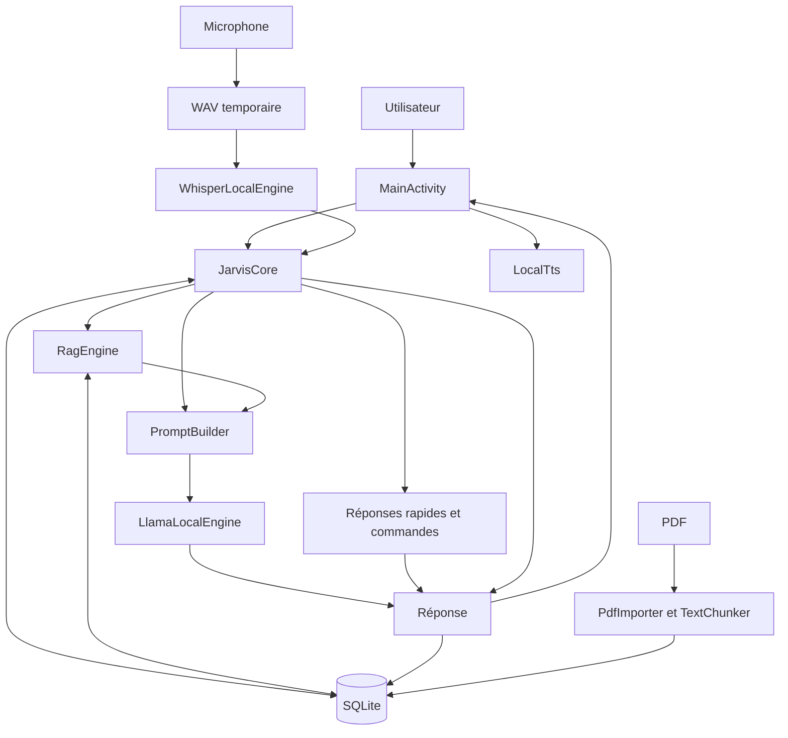

# Connaissances techniques — JARVIS

## Provenance, preuves et actualisation

Ce document provient de l’audit du commit
`39c6c2207b30b0278bdb8188e44e772eb3fc46be` de
`bubth720/JAVIS-Local-v2`, branche distante `main`.
L’audit a couvert les 33 fichiers suivis, dont 17 fichiers Kotlin.

Les références ci-dessous désignent les fichiers de cette révision. Les
comportements peuvent évoluer : actualiser ce document et `AGENTS.md` après
les changements pertinents, en indiquant la révision et les validations
réellement réalisées. Vérifier un ancien constat avant de le réutiliser.

Terminologie :

- **Confirmé par lecture** : démontré par le code ou la configuration.
- **Implémenté** : chemin de code présent, sans garantie de fonctionnement
  complet sur appareil.
- **Validation historique** : commande ou observation rapportée lors de
  l’audit initial, non reproduite pendant cette formalisation.
- **À vérifier** : dépend du runtime, d’un appareil ou d’une bibliothèque.
- **Recommandation** : évolution proposée, non implémentée.

Les validations historiques ne sont pas reproductibles à partir du seul
texte de ce document : elles nécessitent une chaîne Android, les dépendances,
les modèles et, pour les essais fonctionnels, un appareil approprié. Leur
reproduction dans une nouvelle session n’est pas acquise.

## Vue d’ensemble

JARVIS est une application Android native avec un noyau IA local. Elle combine
réponses déterministes, historique et souvenirs SQLite, recherche lexicale
dans les PDF, génération llama.cpp, transcription Whisper et TTS Android.

Un seul module Gradle existe : `:app`. Aucun serveur applicatif, moteur OCR,
index vectoriel ou registre d’outils n’est présent.

## Cartographie complète

### Construction et configuration

| Fichier | Rôle |
|---|---|
| `settings.gradle.kts` | Dépôts de dépendances et module `app` |
| `build.gradle.kts` | Versions AGP et Kotlin |
| `gradle.properties` | Mémoire Gradle, AndroidX et conventions Kotlin |
| `app/build.gradle.kts` | SDK, ABI, variantes, packaging et dépendances |
| `app/proguard-rules.pro` | Conservation des classes llama/Whisper et suppression d’avertissements Apache |
| `app/src/main/AndroidManifest.xml` | Application, activité de lancement et permissions |
| `tools/prepare_models.sh` | Téléchargement des deux modèles |
| `.github/workflows/build-apk.yml` | Construction et publication manuelles |
| `.gitignore` | Ignore caches, builds, configuration locale et modèles |

### Ressources et documentation

Les ressources sont sous `app/src/main/res/`.

| Fichier | Rôle |
|---|---|
| `layout/activity_main.xml` | Conversation, saisie et boutons PDF/voix/mémoire/personnalité |
| `layout/row_message.xml` | Présentation d’un message et de sa source |
| `values/colors.xml` | Palette |
| `values/themes.xml` | Thème Material |
| `values/strings.xml` | Ressource `app_name` ; de nombreux textes sont codés ailleurs |
| `app/src/main/assets/models/README.txt` | Modèles attendus |
| `README.md` | Objectifs, fonctions annoncées et construction |
| `docs/ARCHITECTURE.md` | Architecture succincte et évolutions prévues |

### Composants Kotlin

Sources : `app/src/main/java/com/stark/jarvislocal/`.

| Fichier | Responsabilité |
|---|---|
| `JarvisApplication.kt` | Initialisation PDFBox et du graphe |
| `AppGraph.kt` | Construction des composants partagés |
| `MainActivity.kt` | Interface, permissions et orchestration |
| `MessageAdapter.kt` | Affichage RecyclerView des messages |
| `Models.kt` | Messages, souvenirs, passages, résultats et réglages |
| `JarvisCore.kt` | Routage des requêtes et production des réponses |
| `PromptBuilder.kt` | Assemblage du contexte textuel |
| `LlamaLocalEngine.kt` | Chargement et génération LLM |
| `ModelManager.kt` | Installation des modèles depuis les assets |
| `LocalDatabase.kt` | Persistance SQLite |
| `SettingsStore.kt` | Préférences |
| `PdfImporter.kt` | Extraction des PDF |
| `TextChunker.kt` | Découpage du texte |
| `RagEngine.kt` | Recherche lexicale |
| `WavRecorder.kt` | Capture audio et WAV |
| `WhisperLocalEngine.kt` | Transcription |
| `LocalTts.kt` | Synthèse vocale |

## Technologies et plateforme

Sources : `build.gradle.kts`, `app/build.gradle.kts`, workflow CI.

- Java 17 ; Gradle 8.10.2 dans la CI.
- AGP 8.7.3 ; Kotlin 2.0.21 ; coroutines 1.9.0.
- Android `minSdk=24`, `compileSdk=35`, `targetSdk=35`.
- ABI empaquetée : `arm64-v8a`.
- Android Views, AppCompat, Material Components et RecyclerView.
- `llama-android:0.1.1`, `whisper-android:1.0.0`, `pdfbox-android:2.0.27.0`.
- `SQLiteOpenHelper`, `SharedPreferences` et `TextToSpeech`.

Le dépôt audité ne contient ni Gradle Wrapper, ni tests automatisés, ni
verrouillage des dépendances, ni configuration Gradle de vérification des
dépendances. Ces absences concernent les fichiers suivis de la révision auditée.

## Flux de fonctionnement

### 1. Démarrage

`JarvisApplication.onCreate()` initialise PDFBox et construit `AppGraph`.
`MainActivity` installe les vues, les actions et les marges système, affiche
les 100 derniers messages puis prépare les modèles.

Les instances du graphe appartiennent à l’application ; les coroutines de
l’activité sont liées à son cycle de vie.

Sources : `JarvisApplication.kt`, `AppGraph.kt`, `MainActivity.kt`.

### 2. Modèles

Modèles attendus : Qwen3-1.7B-Q4_K_M, renommé `jarvis.gguf`, et Whisper base
multilingue, renommé `whisper.bin`. Ils ne sont pas suivis dans Git.

Le script les télécharge avant construction. `ModelManager` les copie depuis
les assets vers `filesDir/models`, écrit un fichier `.part` puis le renomme.
Il ignore la copie si la destination dépasse 1 Mo.

Après la copie des deux modèles, l’activité précharge le LLM. Celui-ci reste
en mémoire. `LlamaLocalEngine` sérialise chargement et génération avec un
`Mutex`, utilise un contexte de 2048 tokens et un maximum de 256 tokens
générés par défaut, ainsi que deux à six threads. Il recharge le modèle si
la taille du contexte change.

Whisper n’est pas préchargé : il est chargé puis libéré à chaque transcription.

Sources : `ModelManager.kt`, `LlamaLocalEngine.kt`, `WhisperLocalEngine.kt`,
`Models.kt`, `tools/prepare_models.sh`.

### 3. Message utilisateur

`MainActivity.send()` lance `JarvisCore.chat()` avec un délai coroutine de
90 secondes. Le noyau traite dans cet ordre :

1. Réponses rapides : salutations, remerciements, identité, heure.
2. `/remember` : sauvegarde explicite d’un souvenir.
3. `/docs` : liste des documents.
4. Extrait documentaire direct si l’heuristique et le score le permettent.
5. Génération LLM dans les autres cas.

Les messages sont persistés dans SQLite. L’interface recharge l’historique et
lit éventuellement la réponse. L’ordre du routage peut faire passer une
réponse rapide avant une recherche documentaire.

Sources : `MainActivity.kt`, `JarvisCore.kt`.

### 4. Prompt

La voie LLM récupère jusqu’à quatre passages et quatre souvenirs avec les
réglages par défaut. Elle récupère les messages récents et retire le dernier,
supposé être la question actuelle.

`PromptBuilder` concatène souvenirs, documents étiquetés, historique, question
et marqueur `ASSISTANT`. Chaque message historique est limité à 1400 caractères.
Aucun budget global en tokens n’est calculé. Le prompt système est transmis
séparément au moteur.

La réponse reçoit le premier document récupéré comme source, sans vérifier
qu’elle utilise effectivement cette preuve.

Sources : `JarvisCore.kt`, `PromptBuilder.kt`, `Models.kt`, `SettingsStore.kt`.

### 5. Mémoire

L’ajout est explicite par `/remember` ou le dialogue de mémoire. SQLite
conserve le texte et la date. `RagEngine` compare les termes normalisés de la
question aux souvenirs et retient ceux ayant des correspondances positives.

Il n’existe pas de mémorisation automatique, édition ou suppression.

Sources : `LocalDatabase.kt`, `RagEngine.kt`, `MainActivity.kt`.

### 6. PDF et RAG

Le sélecteur Android fournit un URI. `PdfImporter` extrait le texte page par
page avec PDFBox, préfixe chaque page par `[PAGE n]`, puis découpe le texte en
passages d’environ 1000 caractères avec 180 caractères de chevauchement.

Le document et ses passages sont enregistrés dans une transaction SQLite.
Le PDF original n’est pas copié dans le stockage applicatif. Un document sans
texte exploitable est refusé.

`retrieve()` score les passages selon fréquence et rareté des termes.
`bestEvidence()` recherche des sous-chaînes dans des fenêtres de lignes avec
un seuil de score de 4. Ce RAG est lexical, sans embeddings ni index vectoriel.

Sources : `PdfImporter.kt`, `TextChunker.kt`, `RagEngine.kt`, `LocalDatabase.kt`.

### 7. Voix

Après autorisation du microphone, un premier appui démarre l’enregistrement
et un second demande son arrêt. `WavRecorder` produit
`cacheDir/jarvis_input.wav` : PCM 16 bits, mono, 16 kHz.

Whisper transcrit en français avec un délai coroutine de 60 secondes. Le
texte est envoyé automatiquement au chat. Si `speakReplies` est activé,
`LocalTts` lit la réponse. Il préfère une voix française sans réseau, sans
refuser explicitement les autres situations.

Sources : `WavRecorder.kt`, `WhisperLocalEngine.kt`, `LocalTts.kt`, `MainActivity.kt`.

### 8. APK

Le workflow `workflow_dispatch` récupère le dépôt, prépare Java et Gradle,
télécharge les modèles, construit `assembleDebug`, vérifie les permissions,
calcule le SHA-256 et publie une release GitHub.

La variante publiée est debug. Une variante release minifiée est configurée,
mais n’est pas utilisée par ce workflow. Le hash de l’APK ne vérifie pas
l’authenticité des modèles téléchargés en amont.

Sources : `.github/workflows/build-apk.yml`, `app/build.gradle.kts`,
`tools/prepare_models.sh`.

## Circulation et stockage des données

- SQLite : tables `messages`, `memories`, `documents`, `chunks`.
- SharedPreferences : prompt système et réglages.
- `filesDir/models` : modèles copiés.
- `cacheDir` : WAV temporaire.

Le manifeste retire `INTERNET` et `ACCESS_NETWORK_STATE`, demande
`RECORD_AUDIO` et définit `allowBackup=false`. Aucun chemin applicatif de
communication réseau n’est codé dans le noyau audité. Le TTS est néanmoins
fourni par un moteur Android extérieur à la logique de JARVIS.

Sources : `LocalDatabase.kt`, `SettingsStore.kt`, `ModelManager.kt`,
`MainActivity.kt`, `AndroidManifest.xml`, `LocalTts.kt`.

## Inventaire fonctionnel

| Statut | Capacités |
|---|---|
| Implémenté | Chat, réponses rapides et heure, historique, souvenirs explicites, `/docs`, PDF textuels, recherche lexicale, extraits, génération GGUF, transcription Whisper, TTS, prompt modifiable |
| Implémenté avec limites | Gestion des modèles, annulation et délais, citations, erreurs audio, garantie de TTS hors ligne, cycle de vie |
| Annoncé mais absent | Calculatrice, commande déterministe de date, registre d’outils |
| Documenté comme futur | OCR, recherche vectorielle, TTS neuronal/clonage, Gmail et calendrier |

Sources : code Kotlin, `README.md`, `docs/ARCHITECTURE.md`.
« Implémenté » ne signifie pas « validé sur appareil ».

## Résultats et portée des validations

### Faits vérifiables dans la révision auditée

Les versions, classes, flux, permissions déclarées, absence de tests et
anomalies de code ci-dessous sont établis par lecture des fichiers.

### Validations historiques, non reproduites pendant la formalisation

L’audit initial a rapporté :

- deux constructions `assembleDebug` réussies ;
- signature de l’APK vérifiée ;
- absence de permissions réseau dans l’APK inspecté ;
- bibliothèques ARM64 présentes ;
- `lintDebug` en échec avec 3 erreurs et 34 avertissements ;
- téléchargement des modèles refusé par le réseau (HTTP 403) ;
- absence des deux modèles dans l’APK local ;
- aucun essai sur appareil Android.

Les sorties temporaires de ces commandes ne sont pas ajoutées au dépôt.
Le refus réseau décrit l’environnement de l’audit, pas un défaut universel
du dépôt. La compilation ne démontre pas le fonctionnement de l’assistant.
Reproduire les validations pertinentes avant de revendiquer une nouvelle
révision fonctionnelle. Aucun audit CVE exhaustif n’a été réalisé.

## Diagnostic confirmé par lecture

Les numéros de ligne désignent le commit de référence et peuvent évoluer.

| Gravité | Fichier et preuve | Conséquence |
|---|---|---|
| Critique | `JarvisCore.kt:100` utilise `java.time`, API 26, sans désucrage configuré ; `minSdk=24` | Incompatibilité de l’heure sous API 24/25 ; correspond aux 3 erreurs Lint historiques |
| Critique | `LocalDatabase.kt:17` supprime documents et passages pour `oldVersion < 2` | Migration documentaire destructrice |
| Élevée | `MainActivity.kt:353` arrête le TTS partagé d’`AppGraph` | Aucun mécanisme de reconstruction pour l’activité suivante |
| Élevée | `ModelManager.kt:17-21` ignore la copie au-delà de 1 Mo, mais exige 100/50 Mo pour la présence | Un modèle incomplet peut rester bloquant |
| Élevée | `prepare_models.sh` utilise `main` et vérifie seulement des fichiers non vides | Intégrité et reproductibilité insuffisamment contrôlées |
| Élevée | `LocalDatabase.kt:51` ignore les retours d’insertion | Une transaction peut être déclarée réussie malgré un échec |
| Élevée | `PromptBuilder.kt` n’impose aucun budget global | Risque de dépassement du contexte configuré |
| Modérée | `JarvisCore.kt:67` utilise la première source récupérée | Provenance affichée sans vérification de la réponse |
| Modérée | `RagEngine.kt` recharge et retraite le corpus à chaque requête | Coût croissant avec les documents |
| Modérée | `MainActivity.kt` effectue des accès SQLite sur le thread d’interface | Risque de latence d’affichage |
| Modérée | `PdfImporter.kt` stocke la page dans le texte, sans colonne dédiée | Localisation de source incomplète pour les passages suivants |
| Modérée | Workflow : debug publié, ni tests ni Lint en CI | Distribution et détection des régressions limitées |

Gravité critique : perte de données ou incompatibilité majeure d’une plateforme
annoncée. Élevée : fonction centrale susceptible d’être indisponible ou
incohérente. Modérée : qualité, performance ou maintenance. Les conséquences
runtime non observées restent à reproduire.

## Risques à reproduire ou mesurer

| Gravité | Risque | Preuve de code et validation nécessaire |
|---|---|---|
| Élevée | Mélange des requêtes et du contexte | `MainActivity` permet des envois multiples ; `JarvisCore` retire le dernier message ; seul le LLM est verrouillé. Tester deux messages rapprochés |
| Élevée | Collision de copie des modèles | `ModelManager` n’a pas de verrou et réutilise le même `.part`. Tester une rotation pendant la copie |
| Élevée | Inférence non arrêtée par le délai | `withTimeout` sans arrêt natif explicite. Qualifier llama/Whisper et leur annulation |
| Élevée | Erreur microphone et état incohérent | `WavRecorder` n’encadre pas tout le worker et ne remet pas le drapeau à faux dans `finally`. Tester les erreurs audio |
| Élevée | WAV encore en écriture | `stop()` attend deux secondes puis abandonne la référence au worker. Vérifier la fin effective avant transcription |
| Élevée | Saturation mémoire ou disque | Pas de limites explicites pour PDF, corpus, saisie ou durée audio. Mesurer et tester les grands volumes |
| Modérée | Annulation présentée comme erreur | `catch(Exception)` de `MainActivity` peut capturer une annulation coroutine. Tester destruction et navigation |
| Modérée | Faux positifs documentaires | Sous-chaînes et heuristiques de `RagEngine`/`JarvisCore`. Évaluer sur un corpus de référence |
| Modérée | TTS indisponible ou réseau | `LocalTts` ne garantit pas une voix locale utilisable. Tester le moteur installé hors ligne |
| Modérée | Ressources LLM conservées | Pas de point public de libération lié à la pression mémoire. Mesurer le cycle de vie natif |
| Modérée | Paramètres de découpage invalides | `TextChunker` ne valide pas ses paramètres. Tester la progression avec des bornes incompatibles |

Ces scénarios n’ont pas été reproduits sur appareil lors de l’audit.

## Sécurité et confidentialité

Protections confirmées par configuration : stockage privé Android,
permissions réseau retirées, sélecteur de documents Android, `allowBackup=false`.
L’absence de permissions réseau dans un APK est une validation historique.

| Sujet | Fait ou risque | Source |
|---|---|---|
| Données locales | Pas de chiffrement applicatif explicite ; l’isolation Android reste présente | `LocalDatabase.kt`, `WavRecorder.kt` |
| Audio | Pas de suppression explicite du WAV après transcription | `MainActivity.kt` |
| Injection de prompt | PDF et souvenirs concaténés peuvent influencer la réponse ; aucun outil externe n’est présent pour exécuter ces instructions | `PromptBuilder.kt`, `JarvisCore.kt` |
| Parseur PDF | Contenu externe sans plafond explicite de ressources | `PdfImporter.kt` |
| Modèles | Pas de révision immuable ni empreinte attendue | `prepare_models.sh` |
| Sauvegardes | Absence de règles explicites Android 12+ de transfert/extraction | `AndroidManifest.xml` ; avertissement Lint historique |
| Dépendances | Pas de vérification Gradle ; actions référencées par tags | Configuration Gradle et workflow |
| TLS transitif | Lint historique signale des méthodes de confiance vides dans `bcpkix-jdk15to18:1.72` ; utilisation effective et exploitabilité non établies | Rapport Lint de l’audit |
| Mentions légales | `LICENSE*`/`NOTICE*` exclus du packaging ; aucune licence racine suivie à la révision auditée | `app/build.gradle.kts`, inventaire Git |

Ces constats ne démontrent pas une fuite actuelle ni une vulnérabilité
exploitable. Le TTS doit être évalué comme moteur Android externe ; le retrait
des permissions du noyau ne suffit pas à garantir son fonctionnement hors ligne.

## Limites architecturales et tests manquants

`MainActivity` concentre interface et orchestration. `AppGraph` partage des
composants dont le cycle de vie n’est pas toujours cohérent avec celui de
l’activité. Le domaine dépend directement de SQLite et du moteur concret.
Il n’existe pas d’interfaces de substitution ni d’état de session centralisé.

Les tests manquants portent notamment sur : commandes et ordre de routage,
prompts et budget, découpage, pertinence/citations, migrations, erreurs SQLite,
modèles absents ou tronqués, rotation, concurrence, annulation, microphone,
WAV, TTS hors ligne et variante release minifiée.

## Priorités de stabilisation et critères de réussite

| Ordre | Travail recommandé | Critère de réussite |
|---|---|---|
| 1 — P0 | Tests de référence et compatibilité API 24/25 | Commandes protégées et Lint sans erreur de compatibilité |
| 2 — P0 | Migrations et contrôle des insertions | Données préservées après migration ; échecs remontés |
| 3 — P0 | Cycle de vie TTS/audio, concurrence et copie | Rotation et requêtes rapprochées sans crash ni contexte mélangé |
| 4 — P1 | Modèles épinglés, vérifiés et réparables | Fichier incomplet rejeté ; installation récupérable ; assets contrôlés |
| 5 — P1 | Budget, ressources et annulation native | Entrées longues bornées ; arrêt et récupération testés |
| 6 — P1 | Interfaces, cas d’usage et ViewModel | Capacités existantes préservées et testables |
| 7 — P1 | Recherche et citations | Qualité mesurée ; provenance vérifiable |
| 8 — P1 | CI et distribution de production | Tests/Lint requis, APK release et signature stable |
| 9 — P2 | Outils annoncés mais absents | Calculatrice et date déterministes et testées |
| 10 — P2/P3 | OCR/recherche hybride, connecteurs optionnels | Gains mesurés ; noyau local autonome conservé |

Cette feuille de route est une recommandation, pas une autorisation de
développer. Chaque mission doit préciser son périmètre. Les risques critiques
de compatibilité et de perte de données précèdent les nouvelles fonctionnalités.

## Direction architecturale recommandée

Conserver les implémentations actuelles comme point de départ. Introduire
des frontières interface/session, domaine, persistance, moteur LLM, documents,
voix et futur registre d’outils.

Interfaces possibles : `LanguageModel`, `ModelRepository`,
`ConversationRepository`, `MemoryRepository`, `DocumentRepository`,
`DocumentExtractor`, `DocumentRetriever`, `AudioRecorder`, `SpeechRecognizer`,
`SpeechSynthesizer` et `ToolRegistry`.

Commencer dans le module existant avant d’extraire des modules Gradle. Toute
migration SQLite ou vers Room doit préserver les données. Retourner des
réponses structurées avec provenance plutôt qu’un simple nom de source.
Une politique explicite de concurrence et de ressources natives doit
survivre aux recréations d’activité.

Les connecteurs réseau futurs appartiendraient à une variante distincte,
sans imposer le réseau au noyau local. Cette architecture n’est pas implémentée.

## Vérifications sur appareil et questions ouvertes

- Premier démarrage avec les deux modèles complets ; temps de copie,
  chargement, génération et transcription.
- Mémoire et stockage nécessaires, y compris les copies privées des modèles.
- API 24/25 après correction ; matrice Android ARM64 réellement supportée.
- Rotation pendant préparation, génération et enregistrement.
- Requêtes rapprochées, ordre de conversation et annulation native réelle.
- Réparation de modèles incomplets et gestion de la pression mémoire.
- Permission microphone refusée, microphone indisponible et erreurs de lecture.
- WAV finalisé avant transcription ; TTS français disponible hors ligne.
- PDF volumineux, scanné, protégé ou malformé ; pertinence et citations.
- Migration depuis les installations antérieures ; transferts Android 12+.
- Variante release minifiée et continuité de signature pour les mises à jour.

Restent à préciser : versions natives exactes de llama.cpp/Whisper,
révisions et empreintes des modèles, comportement du prompt composé et de
`/no_think`, cible matérielle minimale, politique de suppression/export des
données, identité de signature et obligations de licence.

Ces questions ne sont pas résolues par la compilation historique. Actualiser
les sections risques et priorités après chaque validation, en conservant
la distinction entre constat de code, reproduction et hypothèse.

## Actualisation — Mission 003 : réponse d’heure sur API 24/25

Base de la correction : `main` au commit
`57c87e953f4a6e36b8068a4d3b4c4c510df14d91`. Les constats d’audit ci-dessus
restent historiques ; l’incompatibilité `java.time` est corrigée par cette
mission, sans modification du SDK minimum.

`JarvisCore.kt` utilise désormais un `SimpleDateFormat` créé à chaque appel,
avec `Date`, le fuseau par défaut et `Locale.ROOT`. Ces API sont disponibles
sur API 24/25. La réponse reste `Il est HH:mm.`, en format 24 heures avec
chiffres ASCII. L’horodatage et le fuseau sont injectables dans la fonction
interne `localTimeReply` pour les tests, sans changer le routage des commandes.

`LocalTimeReplyTest` ajoute sept tests JVM : minuit, zéros initiaux et absence
de secondes, format 24 heures, fuseau à demi-heure, transition d’heure d’été,
changement du fuseau par défaut et locale non latine. JUnit 4.13.2 est ajouté
uniquement via `testImplementation`.

Validations exécutées pour cette correction :

- Avant correction, `lintDebug` reproduit 3 erreurs `NewApi` et 34 avertissements.
- Après correction, les 7 tests passent, sans échec ni test ignoré.
- `assembleDebug` réussit ; `lintDebug` réussit avec 0 erreur `NewApi` et
  34 avertissements restant hors du périmètre de cette mission.
- Signature et absence de permissions réseau vérifiées sur l’APK construit ;
  7 bibliothèques ARM64 présentes.
- Aucun essai sur appareil ou émulateur API 24/25 ; les tests JVM et Lint
  ne remplacent pas cette validation. Les deux modèles restent absents de
  l’APK local, donc le fonctionnement IA complet n’a pas été vérifié.

Le premier défaut de compatibilité est traité. Les priorités relatives aux
migrations, au cycle de vie et aux autres risques restent ouvertes.
