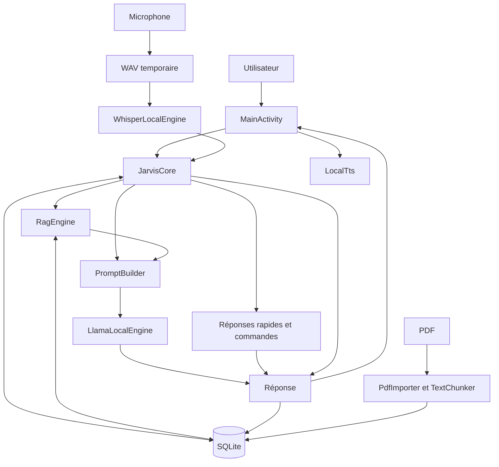

# Connaissances techniques — JARVIS

## Provenance, preuves et actualisation

Ce document provient de l’audit du commit
`39c6c2207b30b0278bdb8188e44e772eb3fc46be` de
`bubth720/JAVIS-Local-v2`, branche distante `main`.
L’audit a couvert les 33 fichiers suivis, dont 17 fichiers Kotlin.

Les références ci-dessous désignent les fichiers de cette révision. Les
comportements peuvent évoluer : actualiser ce document et `AGENTS.md` après
les changements pertinents, en indiquant la révision et les validations
réellement réalisées. Vérifier un ancien constat avant de le réutiliser.

Terminologie :

- **Confirmé par lecture** : démontré par le code ou la configuration.
- **Implémenté** : chemin de code présent, sans garantie de fonctionnement
  complet sur appareil.
- **Validation historique** : commande ou observation rapportée lors de
  l’audit initial, non reproduite pendant cette formalisation.
- **À vérifier** : dépend du runtime, d’un appareil ou d’une bibliothèque.
- **Recommandation** : évolution proposée, non implémentée.

Les validations historiques ne sont pas reproductibles à partir du seul
texte de ce document : elles nécessitent une chaîne Android, les dépendances,
les modèles et, pour les essais fonctionnels, un appareil approprié. Leur
reproduction dans une nouvelle session n’est pas acquise.

## Vue d’ensemble

JARVIS est une application Android native avec un noyau IA local. Elle combine
réponses déterministes, historique et souvenirs SQLite, recherche lexicale
dans les PDF, génération llama.cpp, transcription Whisper et TTS Android.

Un seul module Gradle existe : `:app`. Aucun serveur applicatif, moteur OCR,
index vectoriel ou registre d’outils n’est présent.

## Cartographie complète

### Construction et configuration

| Fichier | Rôle |
|---|---|
| `settings.gradle.kts` | Dépôts de dépendances et module `app` |
| `build.gradle.kts` | Versions AGP et Kotlin |
| `gradle.properties` | Mémoire Gradle, AndroidX et conventions Kotlin |
| `app/build.gradle.kts` | SDK, ABI, variantes, packaging et dépendances |
| `app/proguard-rules.pro` | Conservation des classes llama/Whisper et suppression d’avertissements Apache |
| `app/src/main/AndroidManifest.xml` | Application, activité de lancement et permissions |
| `tools/prepare_models.sh` | Téléchargement des deux modèles |
| `.github/workflows/build-apk.yml` | Construction et publication manuelles |
| `.gitignore` | Ignore caches, builds, configuration locale et modèles |

### Ressources et documentation

Les ressources sont sous `app/src/main/res/`.

| Fichier | Rôle |
|---|---|
| `layout/activity_main.xml` | Conversation, saisie et boutons PDF/voix/mémoire/personnalité |
| `layout/row_message.xml` | Présentation d’un message et de sa source |
| `values/colors.xml` | Palette |
| `values/themes.xml` | Thème Material |
| `values/strings.xml` | Ressource `app_name` ; de nombreux textes sont codés ailleurs |
| `app/src/main/assets/models/README.txt` | Modèles attendus |
| `README.md` | Objectifs, fonctions annoncées et construction |
| `docs/ARCHITECTURE.md` | Architecture succincte et évolutions prévues |

### Composants Kotlin

Sources : `app/src/main/java/com/stark/jarvislocal/`.

| Fichier | Responsabilité |
|---|---|
| `JarvisApplication.kt` | Initialisation PDFBox et du graphe |
| `AppGraph.kt` | Construction des composants partagés |
| `MainActivity.kt` | Interface, permissions et orchestration |
| `MessageAdapter.kt` | Affichage RecyclerView des messages |
| `Models.kt` | Messages, souvenirs, passages, résultats et réglages |
| `JarvisCore.kt` | Routage des requêtes et production des réponses |
| `PromptBuilder.kt` | Assemblage du contexte textuel |
| `LlamaLocalEngine.kt` | Chargement et génération LLM |
| `ModelManager.kt` | Installation des modèles depuis les assets |
| `LocalDatabase.kt` | Persistance SQLite |
| `SettingsStore.kt` | Préférences |
| `PdfImporter.kt` | Extraction des PDF |
| `TextChunker.kt` | Découpage du texte |
| `RagEngine.kt` | Recherche lexicale |
| `WavRecorder.kt` | Capture audio et WAV |
| `WhisperLocalEngine.kt` | Transcription |
| `LocalTts.kt` | Synthèse vocale |

## Technologies et plateforme

Sources : `build.gradle.kts`, `app/build.gradle.kts`, workflow CI.

- Java 17 ; Gradle 8.10.2 dans la CI.
- AGP 8.7.3 ; Kotlin 2.0.21 ; coroutines 1.9.0.
- Android `minSdk=24`, `compileSdk=35`, `targetSdk=35`.
- ABI empaquetée : `arm64-v8a`.
- Android Views, AppCompat, Material Components et RecyclerView.
- `llama-android:0.1.1`, `whisper-android:1.0.0`, `pdfbox-android:2.0.27.0`.
- `SQLiteOpenHelper`, `SharedPreferences` et `TextToSpeech`.

Le dépôt audité ne contient ni Gradle Wrapper, ni tests automatisés, ni
verrouillage des dépendances, ni configuration Gradle de vérification des
dépendances. Ces absences concernent les fichiers suivis de la révision auditée.

## Flux de fonctionnement

### 1. Démarrage

`JarvisApplication.onCreate()` initialise PDFBox et construit `AppGraph`.
`MainActivity` installe les vues, les actions et les marges système, affiche
les 100 derniers messages puis prépare les modèles.

Les instances du graphe appartiennent à l’application ; les coroutines de
l’activité sont liées à son cycle de vie.

Sources : `JarvisApplication.kt`, `AppGraph.kt`, `MainActivity.kt`.

### 2. Modèles

Modèles attendus : Qwen3-1.7B-Q4_K_M, renommé `jarvis.gguf`, et Whisper base
multilingue, renommé `whisper.bin`. Ils ne sont pas suivis dans Git.

Le script les télécharge avant construction. `ModelManager` les copie depuis
les assets vers `filesDir/models`, écrit un fichier `.part` puis le renomme.
Il ignore la copie si la destination dépasse 1 Mo.

Après la copie des deux modèles, l’activité précharge le LLM. Celui-ci reste
en mémoire. `LlamaLocalEngine` sérialise chargement et génération avec un
`Mutex`, utilise un contexte de 2048 tokens et un maximum de 256 tokens
générés par défaut, ainsi que deux à six threads. Il recharge le modèle si
la taille du contexte change.

Whisper n’est pas préchargé : il est chargé puis libéré à chaque transcription.

Sources : `ModelManager.kt`, `LlamaLocalEngine.kt`, `WhisperLocalEngine.kt`,
`Models.kt`, `tools/prepare_models.sh`.

### 3. Message utilisateur

`MainActivity.send()` lance `JarvisCore.chat()` avec un délai coroutine de
90 secondes. Le noyau traite dans cet ordre :

1. Réponses rapides : salutations, remerciements, identité, heure.
2. `/remember` : sauvegarde explicite d’un souvenir.
3. `/docs` : liste des documents.
4. Extrait documentaire direct si l’heuristique et le score le permettent.
5. Génération LLM dans les autres cas.

Les messages sont persistés dans SQLite. L’interface recharge l’historique et
lit éventuellement la réponse. L’ordre du routage peut faire passer une
réponse rapide avant une recherche documentaire.

Sources : `MainActivity.kt`, `JarvisCore.kt`.

### 4. Prompt

La voie LLM récupère jusqu’à quatre passages et quatre souvenirs avec les
réglages par défaut. Elle récupère les messages récents et retire le dernier,
supposé être la question actuelle.

`PromptBuilder` concatène souvenirs, documents étiquetés, historique, question
et marqueur `ASSISTANT`. Chaque message historique est limité à 1400 caractères.
Aucun budget global en tokens n’est calculé. Le prompt système est transmis
séparément au moteur.

La réponse reçoit le premier document récupéré comme source, sans vérifier
qu’elle utilise effectivement cette preuve.

Sources : `JarvisCore.kt`, `PromptBuilder.kt`, `Models.kt`, `SettingsStore.kt`.

### 5. Mémoire

L’ajout est explicite par `/remember` ou le dialogue de mémoire. SQLite
conserve le texte et la date. `RagEngine` compare les termes normalisés de la
question aux souvenirs et retient ceux ayant des correspondances positives.

Il n’existe pas de mémorisation automatique, édition ou suppression.

Sources : `LocalDatabase.kt`, `RagEngine.kt`, `MainActivity.kt`.

### 6. PDF et RAG

Le sélecteur Android fournit un URI. `PdfImporter` extrait le texte page par
page avec PDFBox, préfixe chaque page par `[PAGE n]`, puis découpe le texte en
passages d’environ 1000 caractères avec 180 caractères de chevauchement.

Le document et ses passages sont enregistrés dans une transaction SQLite.
Le PDF original n’est pas copié dans le stockage applicatif. Un document sans
texte exploitable est refusé.

`retrieve()` score les passages selon fréquence et rareté des termes.
`bestEvidence()` recherche des sous-chaînes dans des fenêtres de lignes avec
un seuil de score de 4. Ce RAG est lexical, sans embeddings ni index vectoriel.

Sources : `PdfImporter.kt`, `TextChunker.kt`, `RagEngine.kt`, `LocalDatabase.kt`.

### 7. Voix

Après autorisation du microphone, un premier appui démarre l’enregistrement
et un second demande son arrêt. `WavRecorder` produit
`cacheDir/jarvis_input.wav` : PCM 16 bits, mono, 16 kHz.

Whisper transcrit en français avec un délai coroutine de 60 secondes. Le
texte est envoyé automatiquement au chat. Si `speakReplies` est activé,
`LocalTts` lit la réponse. Il préfère une voix française sans réseau, sans
refuser explicitement les autres situations.

Sources : `WavRecorder.kt`, `WhisperLocalEngine.kt`, `LocalTts.kt`, `MainActivity.kt`.

### 8. APK

Le workflow `workflow_dispatch` récupère le dépôt, prépare Java et Gradle,
télécharge les modèles, construit `assembleDebug`, vérifie les permissions,
calcule le SHA-256 et publie une release GitHub.

La variante publiée est debug. Une variante release minifiée est configurée,
mais n’est pas utilisée par ce workflow. Le hash de l’APK ne vérifie pas
l’authenticité des modèles téléchargés en amont.

Sources : `.github/workflows/build-apk.yml`, `app/build.gradle.kts`,
`tools/prepare_models.sh`.

## Circulation et stockage des données

- SQLite : tables `messages`, `memories`, `documents`, `chunks`.
- SharedPreferences : prompt système et réglages.
- `filesDir/models` : modèles copiés.
- `cacheDir` : WAV temporaire.

Le manifeste retire `INTERNET` et `ACCESS_NETWORK_STATE`, demande
`RECORD_AUDIO` et définit `allowBackup=false`. Aucun chemin applicatif de
communication réseau n’est codé dans le noyau audité. Le TTS est néanmoins
fourni par un moteur Android extérieur à la logique de JARVIS.

Sources : `LocalDatabase.kt`, `SettingsStore.kt`, `ModelManager.kt`,
`MainActivity.kt`, `AndroidManifest.xml`, `LocalTts.kt`.

## Inventaire fonctionnel

| Statut | Capacités |
|---|---|
| Implémenté | Chat, réponses rapides et heure, historique, souvenirs explicites, `/docs`, PDF textuels, recherche lexicale, extraits, génération GGUF, transcription Whisper, TTS, prompt modifiable |
| Implémenté avec limites | Gestion des modèles, annulation et délais, citations, erreurs audio, garantie de TTS hors ligne, cycle de vie |
| Annoncé mais absent | Calculatrice, commande déterministe de date, registre d’outils |
| Documenté comme futur | OCR, recherche vectorielle, TTS neuronal/clonage, Gmail et calendrier |

Sources : code Kotlin, `README.md`, `docs/ARCHITECTURE.md`.
« Implémenté » ne signifie pas « validé sur appareil ».

## Résultats et portée des validations

### Faits vérifiables dans la révision auditée

Les versions, classes, flux, permissions déclarées, absence de tests et
anomalies de code ci-dessous sont établis par lecture des fichiers.

### Validations historiques, non reproduites pendant la formalisation

L’audit initial a rapporté :

- deux constructions `assembleDebug` réussies ;
- signature de l’APK vérifiée ;
- absence de permissions réseau dans l’APK inspecté ;
- bibliothèques ARM64 présentes ;
- `lintDebug` en échec avec 3 erreurs et 34 avertissements ;
- téléchargement des modèles refusé par le réseau (HTTP 403) ;
- absence des deux modèles dans l’APK local ;
- aucun essai sur appareil Android.

Les sorties temporaires de ces commandes ne sont pas ajoutées au dépôt.
Le refus réseau décrit l’environnement de l’audit, pas un défaut universel
du dépôt. La compilation ne démontre pas le fonctionnement de l’assistant.
Reproduire les validations pertinentes avant de revendiquer une nouvelle
révision fonctionnelle. Aucun audit CVE exhaustif n’a été réalisé.

## Diagnostic confirmé par lecture

Les numéros de ligne désignent le commit de référence et peuvent évoluer.

| Gravité | Fichier et preuve | Conséquence |
|---|---|---|
| Critique | `JarvisCore.kt:100` utilise `java.time`, API 26, sans désucrage configuré ; `minSdk=24` | Incompatibilité de l’heure sous API 24/25 ; correspond aux 3 erreurs Lint historiques |
| Critique | `LocalDatabase.kt:17` supprime documents et passages pour `oldVersion < 2` | Migration documentaire destructrice |
| Élevée | `MainActivity.kt:353` arrête le TTS partagé d’`AppGraph` | Aucun mécanisme de reconstruction pour l’activité suivante |
| Élevée | `ModelManager.kt:17-21` ignore la copie au-delà de 1 Mo, mais exige 100/50 Mo pour la présence | Un modèle incomplet peut rester bloquant |
| Élevée | `prepare_models.sh` utilise `main` et vérifie seulement des fichiers non vides | Intégrité et reproductibilité insuffisamment contrôlées |
| Élevée | `LocalDatabase.kt:51` ignore les retours d’insertion | Une transaction peut être déclarée réussie malgré un échec |
| Élevée | `PromptBuilder.kt` n’impose aucun budget global | Risque de dépassement du contexte configuré |
| Modérée | `JarvisCore.kt:67` utilise la première source récupérée | Provenance affichée sans vérification de la réponse |
| Modérée | `RagEngine.kt` recharge et retraite le corpus à chaque requête | Coût croissant avec les documents |
| Modérée | `MainActivity.kt` effectue des accès SQLite sur le thread d’interface | Risque de latence d’affichage |
| Modérée | `PdfImporter.kt` stocke la page dans le texte, sans colonne dédiée | Localisation de source incomplète pour les passages suivants |
| Modérée | Workflow : debug publié, ni tests ni Lint en CI | Distribution et détection des régressions limitées |

Gravité critique : perte de données ou incompatibilité majeure d’une plateforme
annoncée. Élevée : fonction centrale susceptible d’être indisponible ou
incohérente. Modérée : qualité, performance ou maintenance. Les conséquences
runtime non observées restent à reproduire.

## Risques à reproduire ou mesurer

| Gravité | Risque | Preuve de code et validation nécessaire |
|---|---|---|
| Élevée | Mélange des requêtes et du contexte | `MainActivity` permet des envois multiples ; `JarvisCore` retire le dernier message ; seul le LLM est verrouillé. Tester deux messages rapprochés |
| Élevée | Collision de copie des modèles | `ModelManager` n’a pas de verrou et réutilise le même `.part`. Tester une rotation pendant la copie |
| Élevée | Inférence non arrêtée par le délai | `withTimeout` sans arrêt natif explicite. Qualifier llama/Whisper et leur annulation |
| Élevée | Erreur microphone et état incohérent | `WavRecorder` n’encadre pas tout le worker et ne remet pas le drapeau à faux dans `finally`. Tester les erreurs audio |
| Élevée | WAV encore en écriture | `stop()` attend deux secondes puis abandonne la référence au worker. Vérifier la fin effective avant transcription |
| Élevée | Saturation mémoire ou disque | Pas de limites explicites pour PDF, corpus, saisie ou durée audio. Mesurer et tester les grands volumes |
| Modérée | Annulation présentée comme erreur | `catch(Exception)` de `MainActivity` peut capturer une annulation coroutine. Tester destruction et navigation |
| Modérée | Faux positifs documentaires | Sous-chaînes et heuristiques de `RagEngine`/`JarvisCore`. Évaluer sur un corpus de référence |
| Modérée | TTS indisponible ou réseau | `LocalTts` ne garantit pas une voix locale utilisable. Tester le moteur installé hors ligne |
| Modérée | Ressources LLM conservées | Pas de point public de libération lié à la pression mémoire. Mesurer le cycle de vie natif |
| Modérée | Paramètres de découpage invalides | `TextChunker` ne valide pas ses paramètres. Tester la progression avec des bornes incompatibles |

Ces scénarios n’ont pas été reproduits sur appareil lors de l’audit.

## Sécurité et confidentialité

Protections confirmées par configuration : stockage privé Android,
permissions réseau retirées, sélecteur de documents Android, `allowBackup=false`.
L’absence de permissions réseau dans un APK est une validation historique.

| Sujet | Fait ou risque | Source |
|---|---|---|
| Données locales | Pas de chiffrement applicatif explicite ; l’isolation Android reste présente | `LocalDatabase.kt`, `WavRecorder.kt` |
| Audio | Pas de suppression explicite du WAV après transcription | `MainActivity.kt` |
| Injection de prompt | PDF et souvenirs concaténés peuvent influencer la réponse ; aucun outil externe n’est présent pour exécuter ces instructions | `PromptBuilder.kt`, `JarvisCore.kt` |
| Parseur PDF | Contenu externe sans plafond explicite de ressources | `PdfImporter.kt` |
| Modèles | Pas de révision immuable ni empreinte attendue | `prepare_models.sh` |
| Sauvegardes | Absence de règles explicites Android 12+ de transfert/extraction | `AndroidManifest.xml` ; avertissement Lint historique |
| Dépendances | Pas de vérification Gradle ; actions référencées par tags | Configuration Gradle et workflow |
| TLS transitif | Lint historique signale des méthodes de confiance vides dans `bcpkix-jdk15to18:1.72` ; utilisation effective et exploitabilité non établies | Rapport Lint de l’audit |
| Mentions légales | `LICENSE*`/`NOTICE*` exclus du packaging ; aucune licence racine suivie à la révision auditée | `app/build.gradle.kts`, inventaire Git |

Ces constats ne démontrent pas une fuite actuelle ni une vulnérabilité
exploitable. Le TTS doit être évalué comme moteur Android externe ; le retrait
des permissions du noyau ne suffit pas à garantir son fonctionnement hors ligne.

## Limites architecturales et tests manquants

`MainActivity` concentre interface et orchestration. `AppGraph` partage des
composants dont le cycle de vie n’est pas toujours cohérent avec celui de
l’activité. Le domaine dépend directement de SQLite et du moteur concret.
Il n’existe pas d’interfaces de substitution ni d’état de session centralisé.

Les tests manquants portent notamment sur : commandes et ordre de routage,
prompts et budget, découpage, pertinence/citations, migrations, erreurs SQLite,
modèles absents ou tronqués, rotation, concurrence, annulation, microphone,
WAV, TTS hors ligne et variante release minifiée.

## Priorités de stabilisation et critères de réussite

| Ordre | Travail recommandé | Critère de réussite |
|---|---|---|
| 1 — P0 | Tests de référence et compatibilité API 24/25 | Commandes protégées et Lint sans erreur de compatibilité |
| 2 — P0 | Migrations et contrôle des insertions | Données préservées après migration ; échecs remontés |
| 3 — P0 | Cycle de vie TTS/audio, concurrence et copie | Rotation et requêtes rapprochées sans crash ni contexte mélangé |
| 4 — P1 | Modèles épinglés, vérifiés et réparables | Fichier incomplet rejeté ; installation récupérable ; assets contrôlés |
| 5 — P1 | Budget, ressources et annulation native | Entrées longues bornées ; arrêt et récupération testés |
| 6 — P1 | Interfaces, cas d’usage et ViewModel | Capacités existantes préservées et testables |
| 7 — P1 | Recherche et citations | Qualité mesurée ; provenance vérifiable |
| 8 — P1 | CI et distribution de production | Tests/Lint requis, APK release et signature stable |
| 9 — P2 | Outils annoncés mais absents | Calculatrice et date déterministes et testées |
| 10 — P2/P3 | OCR/recherche hybride, connecteurs optionnels | Gains mesurés ; noyau local autonome conservé |

Cette feuille de route est une recommandation, pas une autorisation de
développer. Chaque mission doit préciser son périmètre. Les risques critiques
de compatibilité et de perte de données précèdent les nouvelles fonctionnalités.

## Direction architecturale recommandée

Conserver les implémentations actuelles comme point de départ. Introduire
des frontières interface/session, domaine, persistance, moteur LLM, documents,
voix et futur registre d’outils.

Interfaces possibles : `LanguageModel`, `ModelRepository`,
`ConversationRepository`, `MemoryRepository`, `DocumentRepository`,
`DocumentExtractor`, `DocumentRetriever`, `AudioRecorder`, `SpeechRecognizer`,
`SpeechSynthesizer` et `ToolRegistry`.

Commencer dans le module existant avant d’extraire des modules Gradle. Toute
migration SQLite ou vers Room doit préserver les données. Retourner des
réponses structurées avec provenance plutôt qu’un simple nom de source.
Une politique explicite de concurrence et de ressources natives doit
survivre aux recréations d’activité.

Les connecteurs réseau futurs appartiendraient à une variante distincte,
sans imposer le réseau au noyau local. Cette architecture n’est pas implémentée.

## Vérifications sur appareil et questions ouvertes

- Premier démarrage avec les deux modèles complets ; temps de copie,
  chargement, génération et transcription.
- Mémoire et stockage nécessaires, y compris les copies privées des modèles.
- API 24/25 après correction ; matrice Android ARM64 réellement supportée.
- Rotation pendant préparation, génération et enregistrement.
- Requêtes rapprochées, ordre de conversation et annulation native réelle.
- Réparation de modèles incomplets et gestion de la pression mémoire.
- Permission microphone refusée, microphone indisponible et erreurs de lecture.
- WAV finalisé avant transcription ; TTS français disponible hors ligne.
- PDF volumineux, scanné, protégé ou malformé ; pertinence et citations.
- Migration depuis les installations antérieures ; transferts Android 12+.
- Variante release minifiée et continuité de signature pour les mises à jour.

Restent à préciser : versions natives exactes de llama.cpp/Whisper,
révisions et empreintes des modèles, comportement du prompt composé et de
`/no_think`, cible matérielle minimale, politique de suppression/export des
données, identité de signature et obligations de licence.

Ces questions ne sont pas résolues par la compilation historique. Actualiser
les sections risques et priorités après chaque validation, en conservant
la distinction entre constat de code, reproduction et hypothèse.

## Actualisation — Mission 003 : réponse d’heure sur API 24/25

Base de la correction : `main` au commit
`57c87e953f4a6e36b8068a4d3b4c4c510df14d91`. Les constats d’audit ci-dessus
restent historiques ; l’incompatibilité `java.time` est corrigée par cette
mission, sans modification du SDK minimum.

`JarvisCore.kt` utilise désormais un `SimpleDateFormat` créé à chaque appel,
avec `Date`, le fuseau par défaut et `Locale.ROOT`. Ces API sont disponibles
sur API 24/25. La réponse reste `Il est HH:mm.`, en format 24 heures avec
chiffres ASCII. L’horodatage et le fuseau sont injectables dans la fonction
interne `localTimeReply` pour les tests, sans changer le routage des commandes.

`LocalTimeReplyTest` ajoute sept tests JVM : minuit, zéros initiaux et absence
de secondes, format 24 heures, fuseau à demi-heure, transition d’heure d’été,
changement du fuseau par défaut et locale non latine. JUnit 4.13.2 est ajouté
uniquement via `testImplementation`.

Validations exécutées pour cette correction :

- Avant correction, `lintDebug` reproduit 3 erreurs `NewApi` et 34 avertissements.
- Après correction, les 7 tests passent, sans échec ni test ignoré.
- `assembleDebug` réussit ; `lintDebug` réussit avec 0 erreur `NewApi` et
  34 avertissements restant hors du périmètre de cette mission.
- Signature et absence de permissions réseau vérifiées sur l’APK construit ;
  7 bibliothèques ARM64 présentes.
- Aucun essai sur appareil ou émulateur API 24/25 ; les tests JVM et Lint
  ne remplacent pas cette validation. Les deux modèles restent absents de
  l’APK local, donc le fonctionnement IA complet n’a pas été vérifié.

Le premier défaut de compatibilité est traité. Les priorités relatives aux
migrations, au cycle de vie et aux autres risques restent ouvertes.

## Actualisation — Mission 004 : conservation des données SQLite

Base de la correction : `main` au commit
`a610382229ccaeffc7cc76ac390b60f0ee2771d7`.

### Preuves historiques et stratégie

L’historique Git complet du fichier `LocalDatabase.kt` établit deux versions :

- Version 1 : commit `5c7375c0deb4209bff1a4895356967e3927b59ca`.
- Version 2 : commit `e1541151a8ff7a4f2f499b95a2926286e0d083c7`.

Les quatre tables et l’index de `onCreate` sont identiques. Le changement de
version avait seulement ajouté la suppression des documents et passages pour
forcer une réindexation. Aucune transformation de schéma n’est nécessaire.

La migration 1 vers 2 ne modifie désormais aucune table ni ligne.
`SQLiteOpenHelper` actualise le numéro de version dans sa transaction.
Le nom `jarvis_local_v2.db`, la version cible 2, les identifiants, le schéma et
les données des installations déjà en version 2 restent inchangés. Une
transition non prévue est refusée par une exception, sans réinitialisation.
Le refus de downgrade par défaut est conservé.

Cette correction empêche les suppressions futures. Elle ne peut pas restaurer
des documents déjà supprimés par l’ancienne migration, sans source de données
ou sauvegarde externe. Elle ne prétend pas migrer des schémas inconnus.

### Insertions et atomicité

Les insertions de messages, souvenirs, documents et passages passent par une
fonction commune utilisant `insertOrThrow`, puis vérifiant explicitement
l’identifiant retourné. Le résultat `-1`, possible avec un trigger
`RAISE(IGNORE)`, provoque aussi une `SQLiteException`.

La transaction documentaire n’est déclarée réussie qu’après toutes les
insertions. Une erreur annule le nouveau document et tous ses nouveaux
passages, sans modifier les données préexistantes. Les erreurs remontent aux
appelants ; aucun comportement d’interface n’est modifié dans cette mission.

### Tests et validations effectués

`LocalDatabaseTest` ajoute 11 scénarios exécutés sous Robolectric 4.14.1 en
mode SQLite natif pour API 24, 25 et 35, soit 33 cas. Une `Application` neutre
évite le démarrage des moteurs. Toutes les bases manipulées sont synthétiques
et isolées ; aucune base d’utilisateur réel n’est ouverte.

La fixture `app/src/test/resources/sqlite/schema-v1-v2.sql` reproduit le
schéma historique indépendamment de `onCreate` et contient des messages,
souvenirs, documents et passages avec identifiants, dates et valeurs nulles.
Les tests couvrent :

- Création, écritures et relecture après réouverture.
- Migration d’une base version 1 et ouverture d’une base version 2.
- Conservation exacte des lignes des quatre tables et de `sqlite_sequence`.
- Conservation des compteurs d’auto-incrémentation et nouvelles écritures.
- Insertions rejetées ou ignorées, avec propagation des erreurs.
- Annulation de tout l’import lorsque le deuxième passage échoue, puis reprise.
- Refus d’une migration non prévue et d’un downgrade, avec conservation du
  numéro de version et des lignes. La version 3 de ces tests est une fixture
  synthétique de refus, pas une version historique connue de JARVIS.

Après résolution d’un problème local de cache Robolectric non accessible en
écriture, les tests avant correction ont reproduit 24 échecs sur 33 cas.
Après correction :

- 33 cas SQLite réussis ; 7 tests d’heure existants réussis ; aucun échec,
  erreur ou test ignoré.
- `assembleDebug` et `lintDebug` réussis ; 0 erreur et 34 avertissements Lint
  préexistants, hors du périmètre de cette correction.
- Signature de l’APK et absence de permissions réseau vérifiées.

Robolectric exécute ces tests sur JVM avec SQLite natif ; ce n’est pas un essai
sur appareil ni émulateur Android. La qualification sur une installation
réelle reste à effectuer avec des données de test sauvegardées. Les modèles
ne sont pas nécessaires à cette validation de persistance ; le fonctionnement
IA complet n’est pas validé par cette mission.

Les défauts historiques de migration destructrice et d’insertions silencieuses
sont traités. Les priorités de cycle de vie, concurrence et ressources des
autres composants restent ouvertes. Le corpus existant est conservé avec son
ancien découpage ; aucune réindexation automatique n’est imposée.

## Actualisation — Mission 005

Référence : mission complète fournie dans `JARVIS_CORE_MISSION_005_Complete.pdf`.
Base : `main` au commit `226e2e8cc3eebd479805b89d035eb5c1cbcad540`, contenant
les missions 003 et 004 et la fusion de la PR #3. Branche de travail :
`fix/mission-005-lifecycle-concurrency`.

### Défauts confirmés dans cette base

Les tâches de `MainActivity` appartenaient à `lifecycleScope`, alors que les
moteurs appartenaient à `AppGraph`. Les envois successifs n’étaient pas exclus
au niveau du noyau ; le mutex LLM ne protégeait pas les écritures et la
construction du contexte. Une rotation arrêtait le TTS partagé, relançait la
préparation et annulait les tâches de l’écran. Le recorder pouvait abandonner
son worker après un `join(2000)` sans confirmer sa fin et sans remise en état
fiable après erreur. Le TTS pouvait conserver une voix réseau si aucune voix
locale française n’était trouvée. Les annulations étaient capturées comme
des erreurs ordinaires.

### Coordination et responsabilités

`SessionCoordinator`, détenu par le graphe applicatif, possède un `StateFlow`
et une portée `SupervisorJob`, sans `Activity`, vue ou callback d’écran.
`MainActivity` observe cet état uniquement pendant son cycle STARTED.
L’accès aux dépendances est normalisé sur le contexte Application.
`JarvisApplication.createGraph()` permet une application neutre de test.

Politique single-flight : préparation, conversation, import documentaire et
chaîne capture/transcription/conversation partagent une seule réservation.
La seconde demande est refusée explicitement. Une saisie n’est vidée que
si sa demande est acceptée. Les boutons incompatibles sont désactivés, mais
la sécurité repose aussi sur le coordinateur et sur un `Mutex.tryLock` couvrant
tout `JarvisCore.chat`, y compris le routage, SQLite, le RAG et le prompt.
Les erreurs et annulations libèrent la réservation après le drainage du travail.
Une annulation avant le premier lancement ne laisse pas de verrou bloqué.

`SessionActions` sépare la politique et les opérations réelles pour les tests.
`LocalLanguageModel`, `SpeechEngine`, `AudioInput` et `WhisperBackend` sont
des interfaces légères de substitution en test. Les bibliothèques et formats
LLM/Whisper de production sont conservés. Aucun service Android, module Gradle,
index vectoriel ou moteur distant n’est ajouté.

### Rotation, arrière-plan et destruction

- Préparation, conversation et transcription déjà acceptées survivent à une
  rotation dans le graphe Application. Le nouvel écran retrouve l’état courant
  et l’historique. Il ne relance pas ces opérations.
- Une capture micro est arrêtée et abandonnée dès `onStop`, y compris lors
  d’une rotation ; elle n’est pas transcrite ni relancée automatiquement.
- En arrière-plan, une génération/transcription déjà acceptée peut terminer,
  mais aucune réponse vocale n’est déclenchée. Le TTS en cours est arrêté.
- Une destruction hors changement de configuration demande l’annulation du
  travail et libère le TTS. Les appels natifs déjà entrés sont drainés ; aucune
  étape suivante de la chaîne ne démarre après cette annulation.
- Une future entrée dans l’écran peut réinitialiser le TTS de façon contrôlée.
  Le modèle LLM peut rester en mémoire dans le graphe Application.
- Après échec de préparation, l’état reste ERREUR et le statut est cliquable
  pour réessayer. PRÊT suppose un préchargement LLM terminé et la présence
  basique du fichier Whisper ; ce n’est pas une vérification complète des modèles.

Une réponse LLM déjà engagée sous protection non annulable peut être persistée
avant la fin de l’annulation du coordinateur. Elle n’est pas doublée ni lue
à voix haute après le départ de l’écran. La mort du processus ne conserve pas
les tâches ; SQLite reste persistant.

### TTS

`LocalTts` initialise paresseusement un seul moteur, expose STOPPED,
INITIALIZING, READY ou UNAVAILABLE et ignore les callbacks d’une génération
déjà libérée. Seule une voix française déclarée sans réseau peut être choisie ;
l’absence de voix ou l’échec d’initialisation/synthèse rend la voix indisponible.
Le texte de la conversation reste disponible. `speakReplies` est conservé.
La rotation arrête la lecture mais ne détruit pas le moteur partagé.
La capture micro commence après l’arrêt de la synthèse pour limiter le retour
de la voix de JARVIS dans son propre enregistrement.

Cette sélection de métadonnées de voix ne démontre pas le comportement réseau
du moteur TTS installé : un essai réel hors ligne reste obligatoire.

### Recorder, WAV et confidentialité

États : IDLE, STARTING, RECORDING, STOPPING, ERROR. Une seule capture est
réservée. Le worker vérifie l’initialisation, le démarrage et les lectures du
périphérique ; les erreurs sont transmises via des résultats asynchrones.
La permission est contrôlée et une révocation lors de la construction du
périphérique est traitée comme une erreur, sans désactiver Lint.

L’arrêt demande `AudioRecord.stop()` hors du thread d’interface pour débloquer
la lecture. Le résultat n’est disponible qu’après fermeture, finalisation,
libération et terminaison confirmée du worker. Aucun `join(timeout)` n’est
utilisé comme preuve de fin. Un arrêt répété est sûr. Une défaillance de
libération place le recorder en quarantaine : aucune nouvelle capture n’est
autorisée avant redémarrage du processus.

Chaque capture utilise un fichier cache unique. `WavFiles` vérifie le format
interne PCM mono 16 kHz / 16 bits, les marqueurs, tailles et présence de données.
Un fichier vide, tronqué, incompatible ou non finalisé n’est pas transmis à
Whisper. Les captures abandonnées/erronées sont supprimées ; le fichier valide
est supprimé après la fin effective de son utilisation par Whisper.
La préparation nettoie les anciens fichiers cache réservés `jarvis_input.wav`
et `jarvis_input_*.wav`, sans supprimer d’autres fichiers ni toucher SQLite.

### Whisper, deadlines et limites natives

Whisper vérifie modèle et WAV avant chargement. Un mutex refuse les tentatives
concurrentes ; tout modèle chargé est libéré dans `finally` après retour natif.
Une erreur récupérable permet une nouvelle tentative. La transcription vide
est signalée sans lancer de conversation vide.

Les API publiques inspectées dans les AAR `llama-android:0.1.1` et
`whisper-android:1.0.0` n’exposent pas d’annulation. Le bytecode de leurs wrappers
appelle synchroniquement `nativeComplete` et `nativeTranscribe` avant de retourner.
Les sections natives et leur attente de fin sont donc protégées par
`NonCancellable` ; les verrous restent détenus jusqu’à leur retour réel.

Les seuils de 90 secondes (conversation) et 60 secondes (transcription) sont
conservés. Un seuil de 5 secondes signale également un démarrage/arrêt audio
anormalement long. TIMEOUT est une alerte : `busy` reste vrai, les nouvelles
opérations sont bloquées et la précédente continue à être drainée. Ce n’est
pas une promesse d’interruption du JNI. Une annulation du coordinateur ne crée
pas de message d’erreur applicative. Les erreurs fatales ne sont pas transformées
en succès ; le traitement existant de l’OOM LLM reste une erreur explicite.

Si un appel JNI ou un pilote ne retourne jamais, aucune libération forcée
ou nouvelle inférence n’est tentée. Il faut arrêter réellement le processus
via Android puis rouvrir JARVIS. Une réouverture d’activité seule ne suffit
pas à réinitialiser une ressource audio mise en quarantaine.

### Tests et validations

Suite : 106 cas réussis, 0 échec, 0 erreur et 0 ignoré lors de la validation
de cette mission. Les 40 cas existants et la fixture SQLite sont inchangés.

| Suite | Cas | Portée |
|---|---:|---|
| LocalDatabaseTest | 33 | Régression SQLite natif, API 24/25/35 |
| LocalTimeReplyTest | 7 | Régression du format d’heure |
| JarvisCoreConcurrencyTest | 6 | Noyau réel, SQLite natif et LLM simulé, API 24/35 |
| SessionCoordinatorTest | 17 | Single-flight, rotation, erreurs, annulation, délais, voix et import |
| WavRecorderTest | 16 | Périphérique simulé, vrai worker/fichier WAV, erreurs et confidentialité |
| WhisperLocalEngineTest | 9 | Backend simulé, WAV réel, concurrence, annulation et libération |
| LocalTtsTest | 9 | Backend simulé, callbacks et cycle de vie |
| OfflineVoiceTest | 3 | Sélection de métadonnées Android, API 24 |
| ModelManagerConcurrencyTest | 2 | Copie de petits assets simulés, fichiers réels et concurrence |
| MainActivityLifecycleTest | 4 | Recréation réelle sous Robolectric, actions simulées, API 24/35 |

Commandes exécutées : `gradle :app:testDebugUnitTest :app:assembleDebug
:app:lintDebug --no-daemon --max-workers=4` et `git diff --check`.
Ressources Android incluses pour les tests d’activité ; `kotlinx-coroutines-test`
1.9.0 ajouté uniquement aux dépendances de test. Aucun modèle volumineux chargé
ou téléchargé pour ces tests. Aucune dépendance cloud ajoutée.

La compilation et Lint réussissent : 0 erreur, 30 avertissements, contre
34 historiques. Signature de l’APK vérifiée ; 7 bibliothèques ARM64 présentes ;
permissions `INTERNET` et `ACCESS_NETWORK_STATE` absentes. Aucun appareil réel
ni émulateur Android n’a été utilisé : Robolectric et les doubles de test
ne démontrent ni une inférence réelle ni une capture/synthèse matérielle.

### Risques résiduels et mission 006

- Vérifier sur appareil : pilote micro bloqué, révocation de permission,
  rotation/arrière-plan, fin de transcription, moteur TTS installé hors ligne,
  température, RAM, consommation et latence avec les modèles complets.
- Annulation native indisponible : les protections empêchent le chevauchement,
  mais ne peuvent garantir la fin d’un appel JNI défaillant.
- SHA-256, références immuables, validation complète et réparation des modèles
  restent à la mission 006 ; les seuils de taille historiques sont inchangés.
- Le cache peut conserver un fichier après arrêt brutal jusqu’à la prochaine
  préparation, ou si la suppression échoue. Le nettoyage n’est pas un effacement
  cryptographique ; aucun chiffrement audio n’est ajouté.
- La conservation après mort du processus repose sur SQLite, pas sur un
  redémarrage automatique des opérations ou de la capture.
- Les autres limites documentaires, de budget du prompt et de distribution
  restent hors du périmètre ; aucune nouvelle release n’est publiée pour valider.

## Actualisation — Mission 004A : intégrité et préparation du CORE

Référence `main` vérifiée pendant la mission :
`226e2e8cc3eebd479805b89d035eb5c1cbcad540`. La branche
`mission-004a-core-stability` conserve le commit local 005 `3ca1ec5` comme
ancêtre et ajoute les compléments ci-dessous. Le `main` distant vérifié ne
contient pas encore ce commit 005. Ne pas traiter sa validation locale comme
une fusion GitHub ou une qualification sur appareil.

- SQLite et schéma v2 inchangés : les corrections historiques sont conservées.
  Tests supplémentaires d'interruption dans la transaction de migration,
  rollback exact puis réouverture/reprise, et refus d'une base existante
  non versionnée sans suppression. Aucune réinitialisation ajoutée.
- Installation des modèles : longueur exacte des assets non compressés, seuils
  historiques et magic, copie `.part`, fsync, renommage local sans supprimer
  préalablement la destination ; reprise par nouvelle copie après échec/crash.
  Ni authentification par hash, ni preuve de complétude interne des tenseurs.
- Contexte LLM borné en octets UTF-8 avec réserve, système pris en compte et
  question trop longue refusée plutôt que coupée. Tous les noms des passages
  inclus sont conservés, sans attribuer au modèle une citation prouvée.
- Chaque nouveau chunk PDF reçoit sa page ; aucun ancien document ou passage
  n'est réécrit. Tests d'import d'un PDF réel synthétique et relecture SQLite.
- Dialogue mémoire : lecture/écriture sur IO, erreur contrôlée, confirmation
  uniquement après insertion réussie. `/remember` conserve son protocole
  historique et ses écritures séparées ; la mémoire peut persister sans
  confirmation si l'historique échoue. Aucun enregistrement automatique.
- SharedPreferences inchangé : tests de conservation et plafonds historiques,
  sans garantie nouvelle de persistance après arrêt brutal (`apply`).

Résultats exécutés le 16 octobre 2026 : 140 cas réussis, 0 échec/erreur/ignoré,
compilation debug et Lint réussis (0 erreur, 30 avertissements), signature,
SDK minimum 24 et absence de permissions réseau vérifiés dans l'APK.
Ces résultats incluent la réexécution des tests 005 ; ce ne sont pas des
validations Android matérielles. Modèles absents de l'APK local, aucun essai
LLM/Whisper réel, micro/TTS physique ou sauvegarde/restauration réelle.

Les livrables actuels, qui précisent les anciens constats devenus obsolètes :

- [Audit et priorités](mission-004a/AUDIT.md).
- [Préservation et stratégie de restauration](mission-004a/DATA_PRESERVATION.md).
- [Matrice et recette Android restante](mission-004a/COMPATIBILITY.md).
- [Contrats futurs, sans intégration](mission-004a/MODULARITY.md).
- [Résultats et limites des vérifications](mission-004a/VALIDATION.md).

Risques persistants : vrais modèles et budget tokenizer à qualifier, sources
sémantiques non garanties, volume PDF/RAG et pression mémoire, `apply` et
préférences invalides, erreurs de lecture DB dans l'observateur UI, absence
d'export/restauration, CI sans tests/Lint et distribution debug. Les propositions
d'interfaces sont documentaires ; aucun composant externe n'est rendu nécessaire
pour le fonctionnement historique. Actualiser cette synthèse après chaque évolution.

## Actualisation — Mission 004B : contrat local d'inférence

Base : `mission-004a-core-stability`, commit
`306a89b7cc33803aba9b7af9c6a553f1bc40f08f`. Le port LocalLanguageModel
conserve ses méthodes historiques et ajoute contrat structuré, préparation,
demande d'arrêt et déchargement. AppGraph utilise une factory paresseuse et un
InferenceController exclusif, moteur historique par défaut. Aucun autre moteur
installé ou connecté ; délégué désactivé hors simulateur injecté.

Le Core transmet séparément système configurable, question, contexte, sources
avec IDs de passages, limites, session et requête. Il refuse les mauvaises
corrélations et fins non attestées avant d'enregistrer la réponse assistant.
Le contrôleur refuse contrat/capacités/budget incompatibles, invalide une
réponse après arrêt ou changement de session et draine les opérations après
annulation. Stop demandé, fin observable et modèle déchargé sont distincts.
Le backend historique reste sans arrêt JNI attesté. Une release échouée ne
perd plus son handle et bloque toute nouvelle opération moteur. Un changement
exige unload confirmé puis sélection explicite ; pas de fallback automatique.

Validation exécutée : 174 cas réussis (140 cas 004A inchangés + 34 nouveaux),
0 échec/erreur/ignoré, debug et Lint réussis (0 erreur, 30 avertissements).
Signature, minSdk24 et absence de permissions réseau vérifiés sur l'APK.
Moteurs natifs simulés pour les nouveaux tests ; aucune recette JNI ou Android
matérielle, aucun modèle téléchargé, aucun transport intermodule ni migration
ou modification de schéma. Les limites 004A restent applicables.

Les textes officiels D4-02 et LLM 003D ne sont pas dans les documents disponibles :
conformité complète non attestée ; seule la règle P2 explicitée dans la mission
est implémentée et testée. Consulter le [rapport](mission-004b/REPORT.md), la
[correspondance à valider](mission-004b/LLM_003D_MAPPING.md) et les
[vérifications](mission-004b/VALIDATION.md). Ne pas annoncer une intégration LLM
opérationnelle ni une coordination entre APK à partir de ces tests locaux.

### Complément 004B — sélection exclusive dans le processus

La livraison `mission-004b-core-backend-lifecycle` réutilise `07cd282` et ajoute
ProcessInferenceAdmission. L'ancienne limite « par contrôleur » est renforcée :
les factories de production et les instances historiques réservent le même
propriétaire de backend avant allocation. Les contrôleurs indépendants ne
peuvent pas charger un autre moteur avant déchargement confirmé. Une libération
inconnue/échouée conserve la réservation, même après remplacement du contrôleur.
Le repli historique reste explicite et nécessite une libération attestée ;
aucun reset global ou contournement des limites Android n'est livré. Les tests
multicontrôleurs restent des simulations, pas une qualification native ou une
coordination inter-APK. Les résultats actuels figurent dans
`docs/mission-004b/VALIDATION.md` ; les 174 cas mentionnés ci-dessus décrivent
la première livraison 004B, avant ce complément.

Validation intermédiaire du complément : 185 tests réussis, 0 échec/erreur/ignoré,
build debug et Lint réussis (0 erreur, 30 avertissements). Les 11 nouveaux
scénarios vérifient l'admission partagée, sa conservation après erreur/délai,
le repli explicite après déchargement et les confirmations tardives. Aucun
résultat CI distant ni exécution native réelle ne sont revendiqués.

Un identifiant monotone de réservation protège également le rechargement de
la même instance contre une confirmation de libération ou quarantaine tardive.
Le contrôleur et le moteur historique confirment leur réservation capturée,
sans libérer celle d'une opération ultérieure.

La dernière validation inclut les deux cas de confirmation tardive sur la même
instance : **187 tests réussis**, 0 échec/erreur/ignoré, compilation et Lint
réussis (0 erreur, 30 avertissements). Il s'agit de la livraison actuelle,
les nombres 174/185 ci-dessus décrivant les étapes précédentes.

## Actualisation — CORE 004C, fixture indépendante

Base `29646448c80568d868a702192df761fc9d7a896d`. Lire
`docs/mission-004c/REPORT.md`, `PROTOCOL.md`, `VALIDATION.md` et `QUALIFICATION.md`.
LLM003E publié vérifié en lecture : `5751646acd4a7bb13caaea4b96a4ab3a68ec6adb` ;
D4-02C : `0dbb978994994fa3210124f1e150ca23426d410d`. Les sources `app/`, les
moteurs historiques, SQLite, préférences et protections de processus 004B
ne changent pas. Seule l'inclusion Gradle optionnelle ajoute l'APK expérimental.

La fixture contient le transport AIDL, un service arbitre à permission signature,
un mapping synthétique P2 strict et un journal de bail atomique sans contenu
personnel. Ses tests injectent des endpoints et preuves simulés ; ils ne
valident pas l'inférence interprocessus native. Le serveur doit avoir un
certificat dédié identique à celui de la fixture CORE, sans UID partagé ou
rotation. Les clés ne sont pas livrées dans Git.

Limite confirmée à la lecture de 003E : aucun reçu initial/de reprise ne fournit
l'attestation nécessaire pour réconcilier un arbitre fraîchement lancé. La
production reste donc bloquée RECOVERY_REQUIRED ; hello seul ne déverrouille
pas la génération. Pas de reset, pas de fallback, pas de basculement réel vers
l'application historique. Aucun émulateur/appareil ni GGUF réel vérifié utilisé ;
E2E Android/JNI non exécuté. Actualiser ces constats et les résultats à chaque
évolution du contrat, sans transformer les validations simulées en preuve physique.

## Actualisation — CORE IDENTITY 002

Lire `docs/identity-002/REPORT.md` et `VALIDATION.md`. Base 004C
`da40ed7155409b85860a22c1dbbfe35029cea29a`, contrat UNIFIED
`d7c90785ae4263892a6c96e140cfa88206cb4197`, bundle
`431b5212f742bd9028477a6a603acf328c414801873efdd529f45b6ed5e619de`.
Socle `identity/` optionnel : codec Android, manifeste B technique, snapshot
immuable, politique hôte et port strictement en lecture seule. Ne jamais
désérialiser une autorisation depuis le manifeste. Désactivé par défaut.
Le backend historique n'expose pas le tokenizer/template réel : aucune injection
dans AppGraph/chat, aucune personnalité runtime validée. La composition exige
un port natif qualifié ; les doubles des tests ne sont pas une attestation.
Ne pas introduire IDENTITY dans la fixture /2. Préserver ses fichiers et les
84 fichiers historiques contrôlés par `python3 tools/check-identity-002.py`.

En cloud : `python3 tools/setup-identity-cloud.py` installe les outils épinglés
hors checkout, puis `bash tools/identity-cloud-env.sh gradle ...` fournit Java17,
Gradle8.10.2, SDK35, CA et proxy hérités aux workers Robolectric. Aucun modèle
ni APK installé. Exécuter les tests app et p2-client avec
`-PincludeP2Fixture=true`, ainsi que les builds, Lint et `tools/check-004c.py`.
Validation actuelle : 226 tests app (dont39 IDENTITY API24/25/35) et36 fixture,
0 échec, erreur ou ignoré ; aucune preuve Android physique/native.

## Actualisation — IDENTITY ID-002T

Base `8adec3e0e8dfdce685a33ef796fc3150facc7f0a`. Lire
`docs/identity-002t/REPORT.md`, AUDIT.md et EXACT_PORT.md. AAR0.1.1 inspecté
par javap/nm : tokenizer C présent, aucune mesure JNI préalable ; compteur
promptTokens post-calcul non exposé par LlamaResult. Aucun port natif exact
implémenté : extension JNI/transaction protégée suspendue avant application.
Le diff proposé est uniquement documentaire, non compilé, non installable seul.
Persona désactivée, code runtime et fixtures inchangés. Ne pas mesurer via
complete(maxTokens=0) ou embeddings : ces appels modifient l'état natif.

`tools/audit-identity-tokenizer.py --aar ...` (via identity-cloud-env.sh pour
JAVA_HOME) inspecte l'artefact existant et vérifie les fichiers de la base.
Nouvelle suite de séparation des sources : IdentityTokenizerBoundaryTest ;
6 cas API24/25/35 sans comptage natif fabriqué. Validation :268 tests réussis,
0 échec/erreur/ignoré ; builds/Lint réussis. check-004c.py reste en échec car sa
règle contre004B refuse déjà les ajouts ID-002 de8adec3e ; ne pas le masquer,
voir RESULTS.md. Les autres contrôles de préservation passent. Même modèle,
worker, bail, template et IDs de tokens doivent être qualifiés avant activation.

## Actualisation — ALPHA1-001

Base exacte71831913, branche `feature/alpha1-001-text-lab`. Lire
`docs/alpha1-001/` avant reprise. Laboratoire textuel volontaire, état RAM,
chemin A dans CORE avec même LlamaLocalEngine ; comportement historique par défaut.
Aucune injection Athéna, aucune mesure native exacte nouvelle, aucun changement
JNI/admission/protections ou fixture /2. CORE004D reste bloquée pour le chemin B.
Ne pas confondre requestStop UNSUPPORTED, annulation logique, retour JNI et unload.
Les tours sont armés avant dispatch : l'annulation d'un tour encore en file interdit
son entrée moteur. Un échec de nettoyage conserve les refus existants.

Validation :299 tests (263app +36fixture), zéro échec/erreur/ignoré ; builds/Lint
réussis,27 avertissements app. Aucun GGUF réel, émulateur, installation ou test
physique ; corpus40 NON EXÉCUTÉ et persona désactivée. Les anciens check-004c.py et
check-identity-002.py échouent sur leurs règles absolues de préservation ; ne pas
masquer ces échecs ni assouplir leurs assertions. Le nouveau
`python3 tools/check-alpha1-001.py` protège la base exacte avec un périmètre
explicite, sans autoriser de modification native. Rapports et détails dans
VALIDATION.md et TEST_RESULTS.json. Toute qualification native/persona et essai
physique restent soumis aux gates documentés et aux autorisations distinctes.

## Actualisation — PREVIEW-001

Base b2ec98238f70e89edc636c1c671f2ddf1b957d74, branche
`release/preview-001-android`. Variante :app:assemblePreview, applicationId
com.stark.jarvislocal.preview001, launcher PreviewActivity et signature debug.
Lire docs/preview-001/. Accueil sans chargement ; laboratoire textuel après
confirmation seulement, sortie sans retour vers le mode historique. Variante
normale conservée (bool jarvis_preview=false), JNI/admission/ModelManager/budgets
et contrats inchangés. Aucun GGUF/importeur dans le kit, aucune conversation réelle
ou personnalité Athéna validée ; VOICE/avatar inactifs, permission micro retirée.
311 tests :263 historiques +36 fixture +12 Preview API24/25/35 Robolectric ;
0 échec/erreur/ignoré. Builds/Lint réussis,27 avertissements debug/28 Preview.
Aucun émulateur disponible (/dev/kvm, emulator et system-images absents), aucune
installation personnelle. Autorisation explicite requise avant essai POCO manuel.
Workflow Preview001 dédié sans téléchargement de poids, contents:read, upload-artifact ;
ancien workflow modèles non utilisé. Certificat debug potentiellement différent
entre builds : ne pas proposer de désinstallation ou mise à jour d'une installation
existante. tools/preview_kit.py produit des preuves propres à chaque APK ;
tools/check-preview-001.py protège151 fichiers de base. Ne pas confondre l'APK
locale avec le kit signé par Actions. Provenance/licence/hash et qualification d'un
futur GGUF/import SAF restent une mission séparée. Aucun patch ALPHA1-002 appliqué.

Publication PREVIEW-001 vérifiée : run Actions39123386767 SUCCESS, artefact
12134764891 JARVIS-PREVIEW-001-Android, source d0e2808b20dd646555b4a4d1ebadcb46b6609709.
Voir docs/preview-001/PUBLICATION.json. Téléchargement avec connexion GitHub ;
requête anonyme404. Aucun ZIP téléchargé/re-hashé dans le cloud, ne pas confondre
le digest d'archive GitHub avec le SHA APK local. La clôture documentaire ne change
pas le code de fabrication. Installation physique toujours en attente d'accord.

## Évolution — MVP-001, variante conversationnelle isolée

Base vérifiée Preview86ea8bfa94deea0bab94914cd7214bc395a83f9b ; voir docs/mvp-001/
pour preuves de cette mission. MvpApplication compose un unique InferenceController
historique, MvpRuntime et MvpModelStore. Elle n'initialise ni SQLite, ni voix, ni
IDENTITY. Les fonctions historiques restent dans les variantes existantes.
L'import SAF attend une provenance/licence déclarées, un SHA-256 externe et une
taille exacte ; le stockage privé content-addressé conserve les anciens fichiers,
le pointeur sélectionné utilise AtomicFile. Aucun modèle n'est téléchargé.
LlamaLocalEngine reçoit un constructeur additionnel de chemin/validateur ; aucun
changement du backend natif, de ModelManager, du schéma ou de l'admission.
Le prompt système est séparé ; PromptBuilder borne l'historique en RAM et le
contexte par octets conservateurs, sans prétendre mesurer les vrais tokens.
Les gardes RAM/batterie/température s'appliquent au MVP. Elles ne prouvent pas un
arrêt natif instantané et l'API24 utilise la température batterie comme proxy,
pas une mesure thermique SoC. La qualification réelle nécessite Android ARM64
et un GGUF autorisé/compatible ; ne pas confondre build et inférence réussie.

## Évolution — MVP-002

Mvp2Application compose une unique instance du contrôleur historique et de JarvisCore,
LocalDatabase/SettingsStore/RagEngine, via CoreConversationAdapter. Le port de
conversation est optionnel dans le runtime partagé ; la composition persistante
n'écrase pas l'identifiant de session ouvert par CORE. Historique et mémoires
restent dans SQLite schema2, sans migration ni suppression ; une commande mémoire
est explicite et confirmée par l'UI. Le package distinct ne transfère aucune
base d'une autre application. Les écritures mémoire/messages restent séparées.
L'avatar est un vector drawable statique adapté d'INTERFACE, sans moteur ni horloge.
LocalTts refuse aussi une voix marquée non installée. Mvp2Speech sépare voix prête,
phrase test, attestation utilisateur, commande de lecture et arrêt ; aucun reçu
acoustique automatique. Le mode avion n'atteste pas seul l'absence de Wi-Fi.
Les imports vocaux privés restent séparés des GGUF ; validation ≠ qualification.
Le microphone est refusé dans cette livraison et la saisie textuelle reste active.
Le chemin Whisper historique est inchangé, son activation/admission sûre et son
modèle doivent être qualifiés avant raccordement. Aucun pilote VOICE005K/Binder
ou modèle/profil vocal externe n'est chargé. Voir docs/mvp-002/ pour les résultats
réellement obtenus et les limites physiques ; pas de présomption de JNI fonctionnel.

## Actualisation — MVP-003 : qualification Android

Base MVP002 vérifiée : `c7fec293791dc0b30c83d712e0fae0bbf59736a0`.
La variante mvp3 (`com.stark.jarvislocal.mvp003`) réutilise l'UI et le chemin
CORE de MVP002, avec label de diagnostic et stockage isolé. Pas de migration,
changement natif/SQLite/admission ou deuxième backend. Correctif limité TTS :
un prérequis mode avion observé faux/inaccessible invalide phrase et confirmation
définitivement ; un nouveau test est exigé. Cela ne surveille pas le réseau du
service externe ni les changements non observés.
Les preuves exécutées sont dans docs/mvp-003/TEST-RESULTS.json, RESULTS.json
et validation.log ; les preuves APK finales dans LOCAL-APK-INFO.json. Les
anciennes validations ne remplacent pas celles de cette mission. Génération
GGUF native, audition, micro et essais physiques ne sont pas qualifiés ;
le micro reste désactivé, les extensions NEXUS/SERVICES/EVOLUTION sont des
marqueurs inactifs. Aucun export/restauration applicatif Android livré.
Consulter GUIDE.md et DEVICE-QUALIFICATION.md avant toute autorisation d'essai.
Le statut demeure « candidate de diagnostic », sans promesse de conversation
opérationnelle. Actualiser ces connaissances après toute qualification réelle.

## Actualisation — MVP-004 : qualification native bloquée

Base exacte MVP00390215258ad3914cd6576971334ecb8ca48db74ff.
La mission conserve tous les fichiers applicatifs et dépendances à l'identique.
Le modèle candidat Qwen3-0.6B-Q4_K_M est identifié par révision/LFS/taille dans
MODEL-PROVENANCE.json ; sa licence épinglée a été lue. Les octets GGUF n'ont
pas été obtenus sans autorisation : SHA indépendant, architecture du fichier,
tokenisation et chargement restent non qualifiés. Le lecteur Python préparé
ne change pas les règles ModelManager/MvpModelStore ni l'admission.
La source native de référence reconnaît ChatML, sans interpréter tout le Jinja
Qwen3 ; support de raisonnement, fallback SYSTEM et encodage JNI à qualifier.
La CI MVP00339634143182 est réellement en succès, artefact12360079506 annoncé ;
son ZIP n'a pas été rehaché, redirection Azure refusée. Aucun Android ARM64
exécutable ni appareil personnel utilisé ; aucune conversation native obtenue.
Docs/mvp-004/ distingue les nouvelles régressions exécutées des essais natifs
non exécutés. NO-GO personnel, aucun modèle/IPC/persona activé. Maintenir cette
entrée à jour après toute autorisation et preuve de qualification ultérieure.

## CORE-01 intensive — capacités locales opt-in

Nouveau package `orchestration/` : enveloppe d'intention in-process versionnée,
registre sans écrasement, permissions hôte séparées du contenu, routage explicite
et suivi borné en RAM. Les adaptateurs réutilisent LocalDatabase, RagEngine et
l'horloge historique. Pas de heuristique LLM, migration, IPC ou deuxième moteur.
MVP2/MVP3 expose l'activation puis historique/documents/recherche/heure dans la
palette existante ; chaque inspection emprunte le même gate MvpRuntime. Les
résultats sont indiqués comme lectures locales, aucune génération IA simulée.
Le prototype de conversation réutilise chatVolatile mais demeure indisponible
faute de qualification native ; IDENTITY et les fixtures restent inchangés.
Le quota des IDs acceptés est256 par façade/processus ; un refus QUOTA n'entraîne
ni effacement de journal ni reset d'admission. Voir REPORT-CORE-01.md pour les
commandes, résultats frais et limites. La fin de tâche n'atteste aucun unload.

## CORE-02 — événements locaux observables

AppGraph expose `events`, `eventUi`, `connectors`. Le bus reste désactivé tant que
l'hôte ne choisit pas `graph.events.setEnabled(true)` ; aucun état observé ne
commence une opération ni ne donne des droits. SessionCoordinator conserve ses
gates/timeout/drainage et publie entrée/réflexion/fin/erreur/annulation sans texte.
RESPONSE_CHUNK et SPEECH_REQUESTED sont des types réservés aux producteurs
réels futurs, pas une promesse de streaming ou de voix déjà raccordée. Le journal
métrique optionnel reste RAM, avec durées seulement quand début et fin observés.
Les ports externes restent indisponibles même quand leur découverte est activée.

## ID-01 — profils éditoriaux locaux et contrats conservés

ProfileRepository : SQLite de laboratoire distincte, création/sélection de profils,
révisions optimistes, hash strict, restauration par nouvelle révision et journal
d'origine, sans migration historique. ProfileDraft est immuable et sépare les
propositions numériques du contrat B. ProfilePreviewEngine expose six scénarios
sans génération et l'aperçu du SYSTEM B identique au formatter de l'ancien composer.
IdentityComposerAdapter délègue seulement la baseline technique approuvée, avec
les mêmes exigences de politique/tokenizer ; Athéna/variantes restent refusées
par CONTRACT_EXTENSION_REQUIRED. PersonaExpressionPort ne donne que contexte,
style et tutoiement, aucun texte libre, souvenir ou permission. Aucun runtime
activé ni nouveau stockage de données utilisateur effectué par cette livraison.

## MEM-01 — consentement et mémoire de laboratoire

MemoryApprovalWorkflow prépare des candidats RAM bornés, approuvables seulement
par le contenu affiché exact, la session et une nonce fraîche valable90s. SQLite
confirme mémoire/reçu/audit atomiquement, refuse replays et révisions périmées.
La suppression retire aussi les reçus, pas l'historique de conversation ; suspendre
invalide les anciennes références. Le port de projection est sans cache, expire
immédiatement les vues et exclut toute portée SENSITIVE, même demandée. L'audit
ne conserve ni texte ni digest personnel après suppression. Aucune mémoire
historique importée, requalifiée ou effacée ; pas d'activation dans AppGraph.
La palette MVP2/MVP3 offre un laboratoire isolé après opt-in, avec aperçu, refus,
confirmation positive puis consultation/édition/effacement. Les tests se limitent
aux bases synthétiques et distinguent rollback/restauration manuelle de fixture
d'un service de sauvegarde Android qui n'est pas livré ici.

## ID-02 — styles et intérêts éditoriaux sans activation native

PreferencesCatalog distingue goûts simulés, style configuré et données utilisateur
confirmées, sans convertir un goût en souvenir. ContextStylePolicy réduit l'humour
en contexte travail/urgence ; TemplateRealizer explique les substitutions finies
sur ses seuls gabarits, aucune entrée texte libre. Les règles conflictuelles ou
chaînées sont rejetées, l'urgence suspend les variantes. IdentityChangeJournal
lie une approbation de 90s à l'aperçu et à la révision optimiste ; restauration
ProfileRepository conserve toutes les versions. Extension locale éditeur /2
compatible en lecture avec /1, schéma SQLite inchangé, contrats approuvés intacts.
Aucun goût/configuration créé au lancement, aucun branchement dans l'inférence.

## MEM-02 — rappel confirmé et export volontaire

Base ID-02 corrigée `283423cb8b9d567539f33cf7f2f1fafa602cf974`, les 400 tests
initiaux et 406 après revue restent préservés. MemoryRecallIndex parcourt au plus
200 souvenirs MEM-01 confirmés, sans seconde base ni collecte de conversations.
Session fermée par défaut, scopes explicites, aucune portée SENSITIVE, expiration,
suspension/oubli et lecture fraîche. Égalité lexicale => choix utilisateur, pas une
contradiction sémantique prouvée. MemoryContextAssembler produit un bloc JSON de
données non fiables distinct du documentaire ; son budget UTF-8 n'est pas une
mesure exacte de tokens ni une autorisation de génération.

MemoryExportService : aperçu exact RAM90s, sélection limitée10, JSON32Kio maximum,
révision/source/SHA et consentements toujours revérifiés. Fichiers privés neufs,
confirmation explicite avant écriture ; SAF local facultatif avec nouvel aperçu
après le sélecteur, cible vide obligatoire et relecture SHA. Erreur de copie =>
UNKNOWN, copie privée conservée, jamais suppression/rollback promis du fournisseur.
Le port de chiffrement n'a pas d'adaptateur Keystore qualifié : requête chiffrée
refusée par défaut, export en clair annoncé. Import uniquement en aperçu isolé,
aucune autorité ou confirmation acceptée d'un fichier, aucune API d'importation
automatique. Aucun souvenir historique, profil, JNI ou fixture modifié ; Athéna
inactive. `tools/check-mem-02.py` protège les fichiers amont hors UI opt-in.

## CORE-03 — client de bibliothèques JVM, Android non raccordé

Base MEM-02 `49ad428e94edd75c2a1d115c8c2504f26609eace`. Le projet autonome
`integration-lab/` réutilise NEXUS777e6afa et SERVICES3decdc47, snapshots Git
exacts validés par `tools/prepare-core03-sources.py` et CORE03-SOURCES.json.
Ne jamais substituer les worktrees modifiés ni charger JDBC dans l'APK. Aucun
include/dépendance Android ajouté : source NEXUS JVM17/JDBC et SERVICES java.nio
API26 restent incompatibles/non qualifiés avec le CORE API24 historique.

SourceSearchPort/NexusSearchAdapter conservent et résolvent toutes les citations,
HostAccessPort refuse par défaut et revalide les réponses tardives. ContextAssembler
produit des données JSON non fiables, pas un SYSTEM ni une admission de tokens.
ServicesToolAdapter réutilise registre/Guard/ApprovalGate existants ; toute mutation
nécessite revue exacte et appel propriétaire distinct, aucun accord déduit du texte.
Les approbations du CLI sont synthétiques et ne valent pas décisions utilisateur.
Annuler/timeout d'outil n'atteste aucune fin JNI ou libération. La démonstration est
réelle sur SQLite/FTS5, CSV et DOCX fictifs mais reste JVM, sans connexion APK,
LLM ou mémoire personnelle. CORE-03 global reste PARTIAL. Tout `app/`, fixture,
modèle, budget et fichier de build Android de MEM-02 doit rester identique.

## Actualisation FUSION-01 — laboratoire CORE C0/C1

Base CORE03 aea5ac859ac551d54fe16187c1883a487dbee9d6, descendante de MEM02/ID02 ;
CORE–VOICE reste divergent et non importé. Voir docs/fusion-01/REPORT.md et le verrou
local (pas un GO global UNIFIED). DocumentToolWorkflow relie réellement les bibliothèques
JVM épinglées NEXUS777e6afa/SERVICES3decdc47 : TXT cité, CSV/décimaux, revue/consentement
FIXTURE, export CSV/DOCX réel. Le registre SERVICES existant est utilisé ; les reçus
techniques sont dans son Store, aucune nouvelle mémoire/base CORE. Annulation, timeout
et révocation refusent les résultats tardifs ; états inconnus persistants sans retry.
La révocation n'est pas atomique avec le début d'une écriture producteur, et aucun
rollback n'est garanti : C1 PARTIAL. Android/API24, Binder, LLM et VOICE non raccordés.
Toutes les validations et leurs limites sont détaillées dans le rapport versionné.
Actualiser ces connaissances lors des futures qualifications de producteurs.

## FUSION-02 — état C0 de préparation Android

Base FUSION01 `36761cea101b5f88b87cd4136dc075d28a1adb96` ; voir docs/fusion-02/.
Les producteurs Android n'ont pas encore de GO NEXUS FTS5/API24-25 et SERVICES
SAF/fence. Le NEXUS FUSION01 `9d6928c` réconcilie v4/API24 mais ne revendique
aucune instrumentation exécutée ; ne pas confondre avec NEX374 ou NEX777 compilé
par integration-lab. Le job SERVICES instrumenté vert au SHA f00091a concerne
l'ancienne application API26, pas le SDK API24.

Ajout passif documentToolsReadiness dans AppGraph, réutilisant connectors sans
registre supplémentaire. Les seules sorties sont BLOCKED, UNAVAILABLE et UNKNOWN,
aucune admission/activation même après opt-in demandé ou CONNECTED annoncé.
Aucun fichier/URI, texte, consentement ou modèle n'est transmis. Les données et
réglages historiques, SessionCoordinator, PromptBuilder et moteurs restent intacts.
Le laboratoire JVM demeure distinct ; cet ajout ne constitue pas l'intégration
Android. Actualiser ces constats à partir de nouvelles preuves de producteurs.

## PRE-FUSION lot 2

Projection PinnedDocumentReadiness ajoutée hors AppGraph : lecture de l'existant
DocumentToolReadinessPort, références NEXUS/SERVICES du premier lot, refus constant
d'exécution. Aucun import de producteur, registre, session, modèle ou stockage ajouté.
Le succès logiciel des producteurs ne constitue pas une autorité d'écriture CORE.
