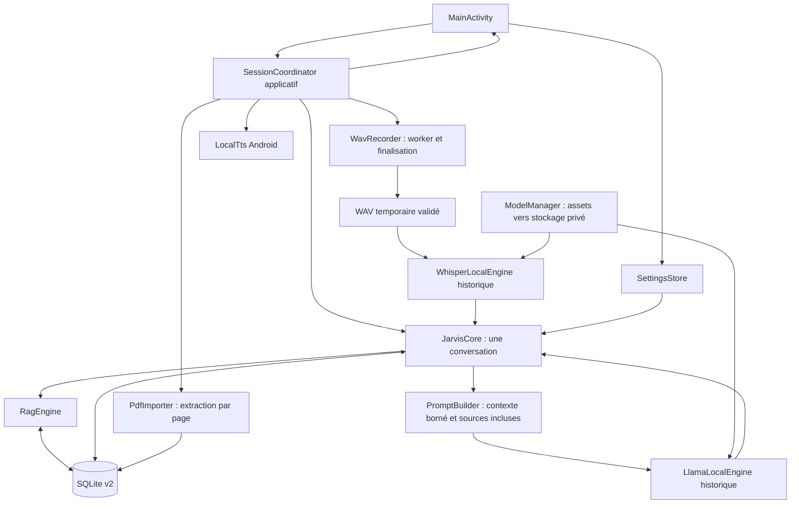

# MISSION 004A — Audit de stabilisation du CORE

## Références et portée

Dépôt unique : `bubth720/JAVIS-Local-v2`. Le `main` récupéré pendant cette
mission est exactement `226e2e8cc3eebd479805b89d035eb5c1cbcad540`.
Branche de livraison : `mission-004a-core-stability`.

Le commit local `3ca1ec5fb72d4e05c35fb8937a3e818b68b41182` (mission 005) est un
enfant direct de cette référence. Il n'est pas fusionné dans le `main` vérifié.
La branche 004A le conserve comme ancêtre : ses corrections et tests sont
réutilisés, sans recréer le travail. Le patch de livraison doit donc inclure
**tous les commits depuis `226e2e8`**, pas seulement le dernier commit 004A.
L'ancienne branche 005, la branche SQLite et leurs patches restent conservés.

Les constats initiaux du commit `39c6c2207b30b0278bdb8188e44e772eb3fc46be`
restent historiques. Le présent audit distingue la base fusionnée, le travail
local réutilisé et les compléments 004A. Les résultats exécutés pendant cette
mission figurent dans [VALIDATION.md](VALIDATION.md) ; une lecture de code,
Robolectric ou une compilation ne prouve pas le fonctionnement sur appareil.
L'ADR-001 externe est une orientation donnée par la mission, pas un fichier
présent ou audité dans ce dépôt. Aucun autre dépôt n'a été consulté ou modifié.

## Cartographie et fonctionnement actuels

Un seul module Gradle `:app`, Kotlin 2.0.21, AGP 8.7.3, Java 17 ; la CI
sélectionne Gradle 8.10.2. `minSdk=24`, SDK cible/compilation 35, ARM64 seul.
Pas de wrapper Gradle. Views XML, Material, AppCompat, RecyclerView,
coroutines 1.9.0, SQLiteOpenHelper et SharedPreferences.

Sources ci-dessous sous `app/src/main/java/com/stark/jarvislocal/` :

| Fichier | Responsabilité actuelle et interactions |
|---|---|
| `JarvisApplication.kt` | Initialise PDFBox puis le graphe applicatif |
| `AppGraph.kt` | Stockage, moteurs historiques et portée coroutine applicative ; relie les actions de session aux composants concrets |
| `SessionCoordinator.kt` | Réserve une opération, publie son état, coordonne chat/import/audio et suit la fin effective des travaux |
| `MainActivity.kt` | Vues, permission micro, sélecteur PDF, saisie, dialogues, observation STARTED et événements de cycle de vie |
| `MessageAdapter.kt` | Affiche messages et champ source ; pas de résolution automatique des citations |
| `Models.kt` | Structures messages/souvenirs/passages/résultats et réglages |
| `JarvisCore.kt` | Verrou conversation, réponses rapides, `/remember`, `/docs`, extraits directs, récupération du contexte, génération et persistance |
| `LocalLanguageModel.kt` | Point de substitution de test du LLM historique ; aucune connexion intermodule |
| `PromptBuilder.kt` | Prépare le contexte borné ; retourne les documents effectivement inclus |
| `LlamaLocalEngine.kt` | Mutex du modèle, chargement et génération locale persistante ; draine les appels non annulables |
| `ModelManager.kt` | Copie des assets non compressés, contrôle taille/magic, installation par renommage local |
| `LocalDatabase.kt` | Version 2 ; messages, souvenirs, documents, passages ; erreurs d'insertion explicites et transaction documentaire |
| `SettingsStore.kt` | Préférences `jarvis_settings_v2` ; caps historiques 2048/256/4, `apply()` |
| `PdfImporter.kt` | PDFBox, extraction page par page, chunks annotés, transaction via la base |
| `TextChunker.kt` | Découpage autour de 1000 caractères, chevauchement de 180 ; paramètres historiques conservés |
| `RagEngine.kt` | Recherche lexicale en mémoire, correspondances de souvenirs et fenêtres de preuves ; pas d'embeddings |
| `WavRecorder.kt` | Worker AudioRecord, PCM 16 kHz mono 16 bits, arrêt confirmé, erreurs et libération |
| `WavFiles.kt` | En-tête WAV, validation de taille/format, nettoyage des seuls noms de cache réservés |
| `WhisperLocalEngine.kt` | Validation modèle/WAV, exclusion mutuelle, chargement/transcription/libération à chaque appel |
| `LocalTts.kt` | Moteur Android recréable, état observable, choix obligatoire d'une voix française déclarée sans réseau |

Autres fichiers inspectés : configurations Gradle racine et app, ProGuard,
manifeste, layouts de conversation/messages, couleurs/thème/chaînes, README,
`docs/ARCHITECTURE.md`, `AGENTS.md`, `docs/PROJECT_KNOWLEDGE.md`, description des
assets, script modèles, workflow, suites `app/src/test` et fixture SQL.
Les assets GGUF/Whisper eux-mêmes ne sont pas suivis. Aucune suite
`app/src/androidTest` n'est présente.

Dépendances métier inchangées : `llama-android:0.1.1`,
`whisper-android:1.0.0`, `pdfbox-android:2.0.27.0`. La reprise 005 ajoute
uniquement `kotlinx-coroutines-test:1.9.0` aux tests et active les ressources
Robolectric. Aucun moteur n'est remplacé.

### Flux et contrats conservés

1. Démarrage : Application → graphe → observation de l'état → préparation en
   IO, nettoyage audio abandonné, copie des modèles, warmup LLM, disponibilité
   Whisper. Une rotation ne recrée pas les composants applicatifs.
2. Message : réservation synchrone de la session, refus d'un second envoi
   occupé avec saisie conservée, puis verrou du noyau. Ordre historique :
   réponse rapide, `/remember`, `/docs`, preuve documentaire directe, LLM.
3. Génération : persistance de la question, recherche lexicale, souvenirs,
   historique sans la question courante, budget du prompt, génération locale,
   persistance de la réponse et noms des documents inclus. Ces noms sont du
   contexte fourni, pas une preuve que le modèle les a réellement utilisés.
4. Mémoire : uniquement demande explicite ou dialogue. `/remember` insère le
   souvenir puis deux messages séparément ; aucune mémorisation automatique.
5. PDF : sélection d'URI → extraction de texte → chunks → insertion atomique
   document/passages. L'original PDF n'est pas copié. Chaque nouveau passage
   reçoit son numéro de page ; le corpus existant n'est pas réindexé.
6. Voix : arrêt TTS → micro → arrêt réel du worker → validation WAV → Whisper
   → chat → TTS si option et premier plan. Le WAV reste présent jusqu'à la fin
   de son utilisateur puis est supprimé. Une erreur de libération du micro
   interdit sa réutilisation jusqu'au redémarrage du processus.
7. Délai/fermeture : le délai signale une opération encore active ; le verrou
   reste pris jusqu'au retour effectif. Une demande d'annulation ne tue pas JNI.
   L'arrière-plan arrête la parole et abandonne la capture en cours ; une
   génération acceptée continue. Une fermeture définitive demande l'annulation
   puis attend la fin réelle des ressources ; aucune reprise après mort du
   processus n'est implémentée. SQLite permet la relecture après redémarrage.
8. Build/publication : workflow manuel télécharge les deux modèles, construit
   debug, inspecte les permissions, calcule le SHA-256 et publie une release.
   Il ne lance pas tests/Lint. Aucun workflow n'a été déclenché par cette mission.

## Corrections historiques vérifiées sur main

- `d7e51b4`/merge `a610382` : `localTimeReply` utilise `Date`, `TimeZone` et
  `SimpleDateFormat` par appel, plus `Locale.ROOT`. Aucun appel `java.time`
  exigeant API 26 sur ce chemin. Sept tests de format/fuseaux sont conservés.
- `7a5b53e`/merge `226e2e8` : schéma v1/v2 identique ; `onUpgrade(1,2)` ne
  supprime rien ; autres transitions refusées ; downgrade refusé par défaut.
  `insertOrThrow` et refus d'id -1 ; transaction document + tous ses passages.
  **Aucune modification 004A de `LocalDatabase.kt`, du schéma ou de la fixture.**

## Diagnostic priorisé : preuves et traitement

Gravité élevée : intégrité/ressource centrale ; modérée : qualité ou latence.
« Corrigé/testé » signifie tests synthétiques, pas qualification Android réelle.

| ID | Gravité / état | Preuve dans les sources de départ | Traitement et preuve reproductible |
|---|---|---|---|
| C1 | Élevée, reprise 005 | `MainActivity.send`, `JarvisCore.chat` : coroutines simultanées, seul moteur sérialisé | `SessionCoordinatorTest`, `JarvisCoreConcurrencyTest` : réservation, refus, contexte ordonné, déverrouillage après erreur |
| C2 | Élevée, reprise 005 | `withTimeout` sans API d'arrêt natif ; `WavRecorder.stop` avec attente limitée | Drainage non annulable, TIMEOUT reste occupé ; tests de barrières JNI simulées et worker audio |
| C3 | Élevée, reprise 005 | `onDestroy` détruit le TTS partagé, préparation liée à l'activité | Graphe/coordinator applicatifs, TTS recréable ; tests rotation réelle Robolectric et callbacks TTS tardifs |
| C4 | Élevée, reprise 005 | Worker audio sans garantie complète d'arrêt/libération/finalisation | Tests échecs permission/init/read/write/stop/release et WAV vide/incomplet ; Whisper libéré en finally |
| D1 | Élevée, complément 004A | `ModelManager.copyAssetIfNeeded` : seuil 1 Mo, `dst.delete()` avant `renameTo` | Taille exacte de l'asset + signature, fsync avant renommage sans suppression de destination ; `ModelInstallationTest`, concurrence conservée |
| P1 | Élevée, complément 004A | `PromptBuilder.build` : agrégation sans limite globale | Chemin `prepare` borné en octets UTF-8 ; question/système trop longs refusés ; `PromptBudgetTest` |
| P2 | Modérée, complément 004A | `JarvisCore` n'enregistre que le premier hit ; page préfixée avant découpage | Tous les noms inclus conservés, page sur chaque nouveau chunk ; tests Core, prompt et vrai PDF synthétique |
| U1 | Modérée, complément 004A | Dialogue mémoire : accès DB sur le thread UI, erreur d'écriture non encadrée | IO dans coroutine, confirmation après insertion réussie, échec contrôlé ; test d'activité succès et trigger de rejet |
| D2 | Protection existante renforcée par tests | Migration version 2 et transactions SQLiteOpenHelper | Interruption injectée après écriture dans la transaction de migration : rollback lignes/version puis reprise ; base version 0 non vide refusée, données conservées |
| D3 | Limite confirmée conservée | `/remember` : trois écritures séparées | Test : souvenir persiste si historique échoue ; documenter absence possible de confirmation, sans promettre atomicité conversationnelle |
| D4 | Limite confirmée conservée | `SettingsStore.save` utilise `apply`, `load` ne réécrit pas | Tests de recréation/caps/clés inconnues ; pas de garantie nouvelle de durabilité après coupure du processus |

## Risques et priorités restant ouverts

| Priorité | Fichier / preuve | Statut et prochaine validation |
|---|---|---|
| P0 avant qualification utilisateur | Moteurs natifs, AudioRecord, TTS, MainActivity | Aucun appareil/émulateur ARM64 ni modèle réel ; exécuter le protocole [COMPATIBILITY.md](COMPATIBILITY.md) avant de revendiquer une stabilité terrain |
| P1 | `tools/prepare_models.sh`, workflow : URLs `main`, `test -s` | Assets non épinglés, pas d'empreinte authentifiée ; taille/magic détectent des copies tronquées mais pas une corruption de même taille/signature ; futur contrôle de manifeste de modèles |
| P1 | `PromptBuilder.prepare` : budget d'octets, marge fixe 128 | Mesure conservatrice, pas tokenizer exact ; réserve de template/tokens à vérifier avec Qwen réel. Des sources trop grandes sont omises du contexte sans être supprimées de SQLite |
| P1 | `SettingsStore` : `apply`, types et bornes inférieures non validés | Sauvegarde asynchrone, réglages corrompus possibles ; qualifier arrêt brutal et lecture d'anciennes préférences. Aucune réinitialisation ajoutée |
| P1 | `PdfImporter`, `RagEngine`, `allChunks`/`allMemories` | Pas de plafond taille/pages/corpus ; extraction et rescoring complets en mémoire. Mesurer OOM/disque plein avec données synthétiques avant optimisation |
| P1 | `LocalDatabase`, manifeste `allowBackup=false` | Aucun export/restauration applicatif ; [DATA_PRESERVATION.md](DATA_PRESERVATION.md) décrit une stratégie, pas une fonctionnalité livrée |
| P1 | Workflow : build debug sans tests/Lint | Ajouter un contrôle CI indépendant des gros modèles dans une mission dédiée ; ne pas lancer ici le workflow de publication APK |
| P2 | `RagEngine.bestEvidence`, sous-chaînes, heuristique du Core | Faux positifs et attribution sémantique non prouvée ; constituer un corpus d'évaluation. Anciens chunks sans page complète conservés |
| P2 | `LlamaLocalEngine.releaseInternal`, ressource persistante | Échec release absorbé, pression mémoire/recréation native non qualifiées ; pas d'arrêt JNI garanti et pas de reprise automatique après crash natif |
| P2 | `MainActivity.refreshMessages`, préférences et métadonnées | Erreur DB à la lecture de l'historique encore susceptible d'interrompre l'observation ; pas de qualification StrictMode/performance exhaustive |
| P2 | `TextChunker.chunk` | Paramètres externes incohérents non protégés ; chemin actuel utilise seulement 1000/180. Tester avant de rendre ces paramètres configurables |
| P2 | Manifeste / TTS externe | Règles Android 12+ de transfert non explicites ; comportement OEM et moteur de parole extérieur à l'UID à tester. Pas de chiffrement applicatif ajouté |
| P2 | Dépendances, ProGuard et Gradle | Pas d'audit CVE exhaustif/verrouillage/signature de dépendances ; avertissements TLS transitifs Lint ne prouvent pas une exploitation ; variante release minifiée non qualifiée |

Le README annonce encore calculatrice et date déterministe, absentes du code.
OCR, embeddings, outils, connecteurs, clonage vocal et intégration inter-APK ne
sont pas implémentés par cette mission. Les frontières futures restent une
proposition dans [MODULARITY.md](MODULARITY.md).

## Ordre de développement proposé

1. Revoir cette branche, résoudre la publication puis qualifier sur Android
   avec corpus synthétique sauvegardé ; aucune fusion automatique.
2. Valider intégrité des modèles et budgets réels avec modèles autorisés.
3. Concevoir export/restauration versionnés, durabilité des réglages et gestion
   des lectures DB en erreur, avec consentement et tests de conservation.
4. Mesurer PDF/RAG et pression mémoire ; renforcer la CI sans publication automatique.
5. Seulement après validation, extraire les contrats décrits ; conserver les
   implémentations historiques tant que leurs remplacements ne sont pas validés.
